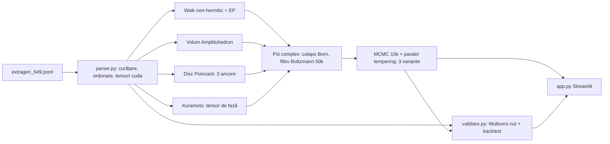
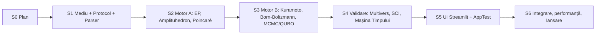

# Plan de execuție multi-sesiune — „Quantum Lab 649” (pistă NOUĂ, separată de DL-649)

> [!IMPORTANT]
> Pista DL-649 rămâne **înghețată și neatinsă**: revizia `20261025T165403Z`, perechea HANDOFF/PROMPT din rădăcină, modelele închise și OGLINDA. Tot lucrul nou stă în `next_candidate/quantum_lab_649/`. Predările acestei piste merg în `next_candidate/quantum_lab_649/predari/`, nu în rădăcină, ca perechea DL să rămână cea activă, neschimbată.

## 0. Constatări (read-only, în această sesiune)

| Element | Stare |
|---|---|
| Pista DL | `verifica_publicarea.py` → exit 0. Incidentele moștenite sunt explicite (`FAIL_HISTORICAL_DRIFT`, 6 diferențe externe, 1 incident tehnic DL), `positive_claims_allowed=false` |
| Date | `next_candidate/predictie_numere/probe_date/extrageri_649.jsonl`: 2595 rânduri, 2595 `draw_key` unice, 1993-08-08 → 2026-10-18. Fiecare rând are 6 numere distincte în 1..49 |
| Anomalii de tratat | 214 `draw_kind=unknown` și 67 `special`. 136 rânduri sunt în zile cu 2 extrageri, iar `within_day_sequence=None` (ordinea din zi e necunoscută). 2 rânduri au dezacord între surse. Ordinea fizică a bilelor e neverificată. Fișierul nu e sortat cronologic |
| GPU | RTX 5060 Laptop, 8151 MiB, driver 595.104.02. Arhitectura Blackwell `sm_120` cere PyTorch cu CUDA ≥ 12.8 |
| Python | 3.12.3. În ambele `.venv` existente lipsesc `torch`, `streamlit`, `pandas`, `plotly` și `scipy` |
| RAM/disc | 15 GiB RAM, 167 GiB liberi |

> [!WARNING]
> **Limita onestă, păstrată în tot produsul.** Operatorii ceruți (non-hermitic/EP, Amplituhedron, Poincaré, Kuramoto, Born+Boltzmann, MCMC) sunt **transformări matematice clasice** ale statisticilor de co-apariție, calculate pe GPU. Ei nu adaugă informație despre extragerea următoare. Dacă extragerile sunt uniforme și independente, niciun operator nu poate da avantaj. Produsul va funcționa complet, va arăta spectaculos și va genera exact 3 variante. „Echilibru termodinamic” înseamnă **minimul energiei modelului**, nu o garanție pentru extragere. Rămân valabile `positive_claims_allowed=false`, fără hardware cuantic și fără avantaj cuantic revendicat. Orice afirmație de performanță trece întâi prin backtestul preînregistrat din S4.

---

## 1. Arhitectură

```
next_candidate/quantum_lab_649/
├── .venv/                      # izolat; nu atinge ENVIRONMENT_LOCK existent
├── PREINREGISTRARE_QL649.md    # protocol + praguri, sigilat SHA-256 ÎNAINTE de calcule pe istorie
├── parser.py                   # STEP 1 – ingestie → tensori CUDA
├── engine.py                   # STEP 2 – cei 6 operatori + fuziune + selecția variantelor
├── validare.py                 # Multivers nul, SCI, backtest walk-forward cauzal
├── app.py                      # STEP 3 – Streamlit cyberpunk
├── verify_ql649.py             # verificator independent (recalcul NumPy fp64, fără import din engine)
├── run_app.sh                  # pornire + jurnal de boot
├── tests/                      # pytest: unitare, paritate CPU/GPU, AppTest Streamlit
├── rezultate/                  # JSON + manifest SHA-256 pentru fiecare rulare
└── predari/                    # HANDOFF/PROMPT ale pistei (+ anexa MESAJE_UTILIZATOR_PERSISTENTE)
```



---

## 2. Idei proprii („magie / SF / quantum”) care chiar fac diferența

| # | Nume | Ce face concret | De ce contează |
|---|---|---|---|
| 1 | **Multiversul Nul** | Rulez pe GPU 2048–8192 istorii sintetice uniforme, cu aceeași lungime și aceeași structură pe zile, prin **exact aceiași operatori**. În UI, fiecare metrică reală apare pe fundalul „norului de universuri paralele”, cu cuantile și p-valoare | E singura cale riguroasă de a separa semnalul de pareidolie. GPU-ul lucrează pentru ce contează |
| 2 | **Indicele de Coerență Structurală (SCI)** | Statistici χ²/G față de ipoteza uniformă, pe frecvențe, pe cele 1176 de perechi și pe goluri. Le combin într-un z-scor calibrat pe Multiversul Nul | Răspunde cinstit la întrebarea „cât de departe e istoria de zgomotul pur” |
| 3 | **Mașina Timpului** | Backtest walk-forward cauzal: la pasul t, motorul vede numai trecutul `< t`. Zilele cu 2 extrageri formează un singur pas de timp, fără ordine inventată. În UI: animație cu loviturile cumulate față de comparatori | Elimină scurgerea retro-cauzală. Arată istoricul real de performanță al motorului |
| 4 | **Recoacere cuantică simulată (Ising/QUBO)** | Cele 3 variante ies dintr-un QUBO: energia modelului, plus o penalizare de suprapunere între variante, plus o penalizare a tiparelor populare. Rezolvarea se face prin paralel tempering cu 50 000 de replici pe GPU | Dă un sens real cerinței de „50 000 de fire Boltzmann”. Variantele sunt diverse, până la 18 numere distincte acoperite |
| 5 | **Scutul Anti-Mulțime** | Penalizare euristică pentru combinații foarte populare: date ≤ 31, progresii, rânduri de pe bilet. `crowd.py` existent e folosit doar ca referință citită, nemodificat | Nu schimbă șansa de câștig. Poate reduce împărțirea premiului. Prezentat strict ca euristică |
| 6 | **Sigiliul Temporal (commit-reveal)** | Variantele primesc SHA-256 cu timestamp UTC înainte de extragere, salvat local. Verificarea se face după extragere | Rezultatele viitoare devin verificabile și nu pot fi rescrise. Complet separat de OGLINDA |
| 7 | **Holograma** | Bilă Poincaré 3D rotativă, cerc Kuramoto animat și planul complex al spectrului non-hermitic, cu traiectoria spre EP | Diferențiere vizuală |
| 8 | **Panoul de ablație** | Comutatoare pentru fiecare operator, cu recalcul live al variantelor și al poziției în Multivers | Arată cinstit ce contribuie fiecare operator |

---

## 3. Definițiile matematice ale operatorilor (fixate în S1, înainte de cod)

- **Walk non-hermitic + EP.** Hamiltonianul este $H(\gamma)=A_{\text{sim}} + i\gamma D$, unde $A$ este co-apariția normalizată, iar $D$ este disiparea diagonală derivată din vechimea numerelor. Evoluția: $\Psi_{t+1}=e^{-iH\Delta}\Psi_t/\lVert\cdot\rVert$, pornind din $\Psi_0=\tfrac{1}{\sqrt{49}}\mathbf{1}$. **Punctele excepționale** sunt valorile γ în care două valori proprii coalesc. Criterii: discriminant minim și vectori proprii aproape coliniari. Procedura: baleiaj GPU pe o grilă γ, apoi rafinare Newton în `complex128`. Referința de test este modelul 2×2 PT-simetric, cu EP exact la $\gamma=\kappa$.
- **„Amplituhedron”** (inspirat; nu este fizica N=4). Pentru fiecare k-uplu (k=2,3) calculez volumul politopului pozitiv generat de coloanele lui $Z$, adică vectorii pozitivi de caracteristici ai numerelor, prin determinanți Gram / minori pozitivi. Amplitudinea unui număr este suma volumelor în care participă. Calcul batch pe cele 18 424 de triplete.
- **Poincaré.** Graful de co-apariție este încorporat în discul hiperbolic prin optimizarea pe GPU a stresului $\sum (d_{\mathbb H}(x_i,x_j)-\delta_{ij})^2$, cu
  $$d_{\mathbb H}(x,y)=\operatorname{arcosh}\!\left(1+\frac{2\lVert x-y\rVert^2}{(1-\lVert x\rVert^2)(1-\lVert y\rVert^2)}\right).$$
  Cele 3 ancore sunt top-3 după centralitatea hiperbolică (raza mică) combinată cu curbura locală Forman/Ollivier.
- **Kuramoto.** Dinamica $\dot\theta_i=\omega_i+\tfrac{K}{N}\sum_j W_{ij}\sin(\theta_j-\theta_i)$, integrată RK4 pe GPU. Când amplitudinea locală $|r_i|$ trece de un prag („spike de interferență”), partenerii primesc o rotație de fază instantanee $\theta_j\leftarrow\theta_j+\alpha W_{ij}$, implementată ca operator explicit de salt.
- **Colaps + Boltzmann.** $P=|\Psi|^2$ în `complex64` pe CUDA. Apoi 50 000 de replici aplică filtrul $p_i\propto e^{-\beta E_i}$ pe o scară de temperaturi. Se păstrează nucleul stabil peste replici.
- **MCMC geometric.** 10 000 de pași Metropolis-Hastings pe spațiul combinațiilor de 6 (mutare prin swap), cu paralel tempering. Echilibrul detaliat se verifică pe instanțe mici, enumerate exact.

---

## 4. Sesiunile

Fiecare sesiune se închide cu un checkpoint verificabil și o predare HANDOFF/PROMPT în `predari/`, ca următorul chat să pornească de la zero context.



### S0 — Planul (sesiunea curentă)
- ✅ Verificare read-only a pistei DL, inventarul datelor și sondarea GPU.
- Livrabil: acest plan. Urmează aprobarea ta.

### S1 — Mediu izolat, protocol sigilat, `parser.py`
1. Creez `python3 -m venv next_candidate/quantum_lab_649/.venv` și instalez `torch --index-url https://download.pytorch.org/whl/cu128` (wheel compatibil cu Blackwell), plus `streamlit numpy pandas plotly scipy pytest`. Scriu un `requirements.lock` cu versiunile exacte.
2. Test de fum GPU: matmul complex, `torch.linalg.eig` pe cuda, kernel cu 50 000 de fire, confirmarea `sm_120`. Fallback-ul pe CPU se activează silențios **numai** la eroare de driver și se jurnalizează.
3. Scriu `PREINREGISTRARE_QL649.md` cu:
   - definițiile din §3 și hiperparametrii fixați;
   - comparatorii: U (uniform), B (frecvență), I (identitate/recență);
   - metrica backtestului și pragurile de promovare, aliniate la porțile proiectului (exces ≥ .20 etc.);
   - regula pentru zilele cu 2 extrageri și tratarea rândurilor `unknown`/`special`;
   - ce se publică și când.

   Protocolul se sigilează SHA-256 **înainte** de orice calcul de operator pe istorie.
4. Scriu `parser.py`:
   - încărcare în RAM și validarea schemei;
   - deduplicare pe `draw_key` și pe perechea (dată, mulțime);
   - sortare cronologică stabilă, gruparea pe zile și raportul de anomalii;
   - ieșiri pe `cuda`: `draws[T,6]`, `onehot[T,49]` și `pair_counts[49,49]`, plus manifestul SHA-256 al sursei.
5. Teste:
   - schema;
   - 2595 → N rânduri curățate, cu fiecare eliminare explicată;
   - paritate CPU/GPU exactă;
   - refuzul intrărilor invalide: număr 0 sau 50, duplicat în rând, dată lipsă.
- **Checkpoint S1**: `pytest tests/test_parser.py` PASS, protocol sigilat, jurnal GPU.

### S2 — Motorul A
- Operatorii 1–3 în `engine.py`, fiecare cu un API pur `f(tensors, cfg, seed) -> dict`.
- Teste cu răspuns cunoscut:
  - EP-ul 2×2 la $\gamma=\kappa$, cu eroare < 1e-8 în fp64;
  - invarianța la permutarea etichetelor;
  - volume ≥ 0 și nule pe configurații degenerate;
  - distanța hiperbolică comparată cu formula închisă și convergența stresului;
  - paritate CPU/GPU în toleranța fixată și determinism la același seed.
- **Checkpoint S2**: teste PASS și profilul VRAM/timp pentru fiecare operator.

### S3 — Motorul B
- Implementez:
  - Kuramoto, cu RK4 și operatorul de salt;
  - Born + Boltzmann pe 50 000 de replici;
  - MCMC cu 10 000 de pași și paralel tempering;
  - QUBO-ul pentru cele 3 variante, cu diversitate și Scutul Anti-Mulțime.
- Teste:
  - parametrul de ordine: r → 1 la cuplaj mare, r ≈ 0 la cuplaj zero; saltul conservă normele;
  - normalizarea Born: $\sum P=1$;
  - MCMC pe o instanță mică (C(10,3)), comparat prin χ² cu distribuția Boltzmann exactă;
  - invariantele variantelor: exact 3, fiecare cu 6 numere distincte din 1..49, unice și sortate.
- **Checkpoint S3**: `engine.run_full()` complet pe GPU în < 60 s, teste PASS.

### S4 — Validarea backend (o singură rulare, preînregistrată)
- `validare.py`: Multiversul Nul (batch GPU), SCI cu p-valori, Mașina Timpului (walk-forward cauzal), comparatorii U/B/I și verdictul față de porți.
- `verify_ql649.py`: recalcul independent în NumPy fp64, fără import din `engine.py`. Recalculează hit-urile backtestului și SCI pe un eșantion de pași.
- Rezultatul se publică **oricare ar fi** (cel mai probabil `NO_PROMOTION_EXPLORATORY`). Nu fac tuning după ce văd rezultatul.
- **Checkpoint S4**: `RAPORT_QL649.md`, JSON, manifest și verificatorul separat PASS.

### S5 — UI Streamlit cyberpunk
- Antetul afișează:
  - numărul de extrageri analizate;
  - SCI, cu poziția în Multivers;
  - VRAM live prin `torch.cuda.memory_allocated()` și `max_memory_allocated`;
  - dispozitivul și ora calculului.
- **Tab 1 – Colaps**: top-10 amplitudini, cu coordonatele de fază în planul complex (Plotly).
- **Tab 2 – Singularitate hiperbolică și Amplituhedron**: discul Poincaré, bila 3D, perechile cele mai „încâlcite” și spectrul EP.
- **Tab 3 – Convergență terminală**: **exact 3 variante × 6 numere**, cu energia, diversitatea, Sigiliul Temporal și eticheta permanentă „exploratoriu, fără avantaj demonstrat”.
- **Taburi suplimentare**: Multiversul Nul, Mașina Timpului, Ablație.
- Motorul rulează o singură dată și rămâne în cache (`st.cache_resource`). Recalculul pornește doar la cerere.
- Teste: `streamlit.testing.v1.AppTest` pe toate taburile (fără excepții, exact 3 variante randate), boot headless și health-check HTTP pe `/_stcore/health`.
- **Checkpoint S5**: AppTest PASS și jurnalul de boot.

### S6 — Integrare, performanță, lansare
- Verificări finale:
  - rulare end-to-end;
  - profil `nvidia-smi`, cu vârf VRAM < 7 GiB;
  - fallback CPU testat cu `CUDA_VISIBLE_DEVICES=""`;
  - `python -m py_compile` pe toate modulele.
- Livrez `run_app.sh` și README-ul cu comanda finală.
- Predarea finală a pistei QL649. Pista DL e reverificată read-only și rămâne neatinsă.

---

## 5. Reguli păstrate pe toată durata

- Fără subagenți, bani, contacte sau joburi autonome. Git numai prin `./dev-git`, fără add/commit.
- Modelele închise (CF, RH, LS, FS, AT, EC, RA, DL…) nu se modifică și nu se rulează. OGLINDA rămâne neatinsă.
- Protocolul se scrie înaintea calculelor pe istorie. Rezultatele negative se publică și nu se rescriu. UNKNOWN nu devine PASS.
- Fiecare predare a pistei include integral, exact o dată, `MESAJE_UTILIZATOR_PERSISTENTE.md` în anexă separată și propagă această obligație.

## 6. Comanda finală (după S6)

```bash
cd ${QL649_ROOT:-.} && ./run_app.sh
# echivalent: .venv/bin/streamlit run app.py --server.headless true --server.port 8649
# apoi deschide http://localhost:8649
```
