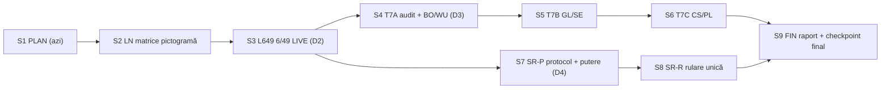

# PLAN PE SESIUNI — TU3 „Tri-Universe Convergence v3.0” (redactat 2026-10-27, Mesajul 38)

Document de planificare (nu protocol, nu cod, nu rezultat). Fiecare sesiune de mai jos = UN submodul, cu
protocol/amendament scris și sigilat ÎNAINTE de cod, teste, apoi oprire + `OPERATIV.md` + supliment +
`genereaza_predare.py` + prompt. Ordinea e o recomandare; utilizatorul poate schimba ordinea sau sări orice sesiune.
`positive_claims_allowed=false`; variantele sunt minime de energie, NU predicții; calcul clasic (GPU/CPU).

## 1. Starea la checkpoint 20261026T190242Z (verificată read-only la 2026-10-27 12:14Z)

- Toate hash-urile corespund; **33 passed, 3 skipped**; matricea: TOATE 3 MODURILE READY, integritate OK (21 fișiere).
- Arhiva LIVE: cicluri 19:00:30Z (26 oct), 11:49Z, 11:52Z, 12:00Z (27 oct), PUBLICAT + dedup, 0 erori.
  Laptopul a fost oprit 15:22→07:49 local (fără linger, fără cicluri în acest interval). `versiuni/` = 7.2 MB
  (10 versiuni, 8 compacte), `--verifica` OK.
- Server pe 127.0.0.1:8649 (pid 6306), pornit de utilizator din pictogramă la 08:10 local → `run_app.sh`, deci
  FĂRĂ matricea de inițializare.
- DL `verifica_publicarea.py` exit 0 (înghețat; `FAIL_HISTORICAL_DRIFT` + 6 diferențe externe moștenite explicite).

## 2. Mesajul 25 (cerința TU3) față de ce există

| Cerință (Mesajul 25 / 28) | Stare | Lipsă |
|---|---|---|
| STEP 1: ingestia 5/40 + Joker, validare strictă, tensori CUDA | GATA (`parser_multi.py`, P) | — |
| STEP 1: date mereu la zi pentru toate 3 jocurile (Mesajul 28) | GATA pentru 5/40 și Joker (LIVE); arhiva LIVE conține și 6/49 | **6/49 în aplicație citește încă sursa înghețată** (2595 extrageri, până la 18 oct; LIVE are 2597, + 22 și 25 oct, 0 diferențe pe cheile comune) |
| STEP 2: motor 5/40 (ψ 1/√40, Kuramoto 40×40, QUBO 5 noduri) | GATA (`motor_n.py`, E40_PASS) | — |
| STEP 2: Joker bi-partit 45⊗20, tensor încrucișat, holonomie | GATA (`joker_entanglement.py`, `motor_joker.py`, J/EJ_PASS) | — |
| STEP 3: selector global, eliberare VRAM, 3 variante după regulă + sigiliu SHA-256 | GATA (`ui_tu3.py`, UI) | — |
| STEP 3: 12 taburi pentru FIECARE mod | PARȚIAL: 1–6 active; 4 (SCI real) și 5 (Mașina Timpului) au componenta pe istoria reală NERULATĂ; **7–12 = „NEAPLICABIL”** la 5/40/Joker (abatere declarată TU3-UI §4) | porturi pentru 7–12 + scorul real (taburile 4–5), fiecare cu protocol propriu |
| STEP 4: validare sintetică γ = 1/2 pe toate 3 căile + server + matrice | GATA (`validare_tu3.py`, `run_app_tu3.sh`, VS_PASS) | **pictograma nu tipărește matricea** (folosește `run_app.sh`) |
| Mesaj 28: actualizare automată | GATA (timer + drop-in-uri arhivă + dedup, DD_PASS) | rulează numai cât e sesiune deschisă (linger dezactivat) — decizia utilizatorului |

## 3. Decizii care îți aparțin (nu le iau eu)

- **D1 — gardul prognozei automate** (kernel 7.0.11→7.2.6). Neatins. Dacă vrei să fie ridicat/adaptat, ceri explicit;
  atunci primește o sesiune proprie (S-G, mai jos), cu amendament.
- **D2 — 6/49 pe LIVE (S3):** permiți un bloc ADITIV în `app.py` (altfel nu se poate: `app.py` citește direct
  `parser.DEFAULT_SOURCE`)? Și care e sursa implicită: (a) LIVE implicit + comutator „înghețat (sigilat)”, sau
  (b) înghețat implicit + comutator „LIVE”. Recomandarea mea: (a); protocoalele sigilate rămân pe sursa înghețată.
- **D3 — taburile 7–12 la 5/40 și Joker (S4–S6):** (a) rămân „NEAPLICABIL” (starea actuală, declarată), (b) porturi
  DESCRIPTIVE (aceleași statistici/grafice pe datele jocului, fără verdict, fără scor, etichetate „descriptiv”),
  (c) teste preînregistrate complete pe 5/40/Joker (pistă științifică, câte una pe sesiune, rezultate publicate
  oricum ar ieși). Recomandarea mea: (b). Verdictele 6/49 (închise) NU se transferă la celelalte jocuri.
- **D4 — scorul pe istoria reală 5/40 / Joker (S7–S8):** îl vrei? Dacă da: protocol + putere sintetică într-o
  sesiune, rularea unică în alta; rezultatul (cel mai probabil nul) se publică și NU se repetă cu alți parametri.
- **D5 — linger** (`loginctl enable-linger tony`): fără el, arhiva se actualizează doar cât ești logat. E o comandă a
  ta, de un minut, fără cod; nu o rulez eu.

## 4. Sesiunile

| Sesiune | Cod | Submodul | Fișiere atinse (restul NEMODIFICATE) | Precondiție |
|---|---|---|---|---|
| S1 (azi) | PLAN | validarea checkpoint-ului + acest plan | numai acest document + predarea | — |
| S2 | LN | matricea în lansatorul pictogramei | `porneste_aplicatia.sh` (→ `run_app_tu3.sh`); test nou | niciuna |
| S3 | L649 | 6/49 pe arhiva LIVE în aplicație | bloc aditiv `app.py`; eventual `ui_tu3.py`; teste noi; `test_app_tu3.py` U1/U8 actualizate prin amendament | D2 |
| S4 | T7A | audit + protocol porturi 7–12; porturi BO (tab 7) + WU (tab 8) | modul nou `tu3/porturi_712.py`; `ui_tu3.py`; teste | D3 = (b) sau (c) |
| S5 | T7B | porturi GL (tab 9) + SE (tab 10) | idem | S4 |
| S6 | T7C | porturi CS (tab 11) + PL (tab 12) | idem | S5 |
| S7 | SR-P | protocol + putere sintetică pentru scorul real 5/40/Joker (taburile 4–5) | modul nou + protocol | D4 = da |
| S8 | SR-R | rularea reală UNICĂ + verdict publicat | rezultate noi 0444; UI afișează verdictul | S7 PASS |
| S9 | FIN | regresie completă, `README`/`RAPORT_TU3.md`, checkpoint final „TU3 complet” | documente; fără cod nou | după S2–S8 (cele alese) |

Detalii pe sesiune:

**S2 — LN (matricea în pictogramă).** Amendament `AMENDAMENT_TU3_LN_01.md` + sigiliu înainte de cod.
`porneste_aplicatia.sh` pornește `run_app_tu3.sh` (care tipărește matricea în `jurnal/matrice_<UTC>.txt` și apoi
face `exec ./run_app.sh`); lansatorul copiază verdictul matricii în jurnalul lui și în notificare
(„TOATE 3 MODURILE READY” sau avertisment), fără a bloca pornirea. `run_app.sh`, `run_app_tu3.sh`, `app.py`
byte-identice. Atenție la `our_pids`/`--stop`: între pornire și `exec`, procesul este `bash ./run_app_tu3.sh` —
oprirea se face prin pgid (deja existent); testul verifică explicit. Testul NU rulează pe 8649 cu serverul tău pornit
(funcția de oprire identifică procesele după director, nu după port) — se face cu serverul oprit și repornit la final,
sau pe o copie izolată. Criterii: matricea apare la pornirea din pictogramă, health ok, `--stop` oprește tot, nu rămân
procese orfane, hash-urile protejate neschimbate, suitele existente verzi.

**S3 — L649 (6/49 pe LIVE).** Protocol `PROTOCOL_TU3_L649.md`. Folosește calea deja existentă
`parser_multi.build_game_dataset("649", "live")` (adaptorul `adapt_649` → `parser.build_dataset`, ambele nemodificate).
Martori: cheile comune LIVE vs înghețat identice (0 diferențe acum; dacă apar vreodată, se AFIȘEAZĂ, nu se repară);
LIVE ⊇ înghețat; sursa activă și sha-ul ei vizibile în UI și în sigiliul de timp; schimbarea sursei eliberează
cache-ul/VRAM (ca la schimbarea modului); calea înghețată rămâne identică cu copia de referință (U1). Validatorul
`validare.py` și orice protocol sigilat rămân pe sursa înghețată. Fișierul înghețat din `predictie_numere/probe_date/`
nu se atinge.

**S4–S6 — T7A/T7B/T7C (taburile 7–12).** O sesiune de audit nu e separată: S4 începe cu inventarul (care funcții din
`bo649`, `wu649`, `gl649`, `se649`, `cs649`, `pl649` depind de N = 49 / 6 bile) și sigilează protocolul comun al
porturilor, apoi face primele două taburi. Pistele închise rămân byte-identice; porturile sunt funcții noi,
parametrizate în n/k, în `tu3/`. Test de identitate: portul rulat pe 6/49 reproduce exact cifrele pistei originale
(martor că portarea e corectă), apoi rulează pe 5/40/Joker. Fără scor, fără verdict nou la (b). Dacă un tab nu are
sens pentru un joc (de exemplu, GL depinde de glifele numerelor 1..49), rămâne „NEAPLICABIL”, cu motivul scris.

**S7–S8 — SR (scorul real).** S7: protocol (ținte, metrică, comparatori uniformi, praguri, ferestre) + putere
sintetică γ = 1/2 pe 5/40 și Joker, ÎNAINTE de orice citire a scorurilor reale. S8: o singură rulare pe arhiva
înghețată, verificare separată, verdict publicat (inclusiv negativ), UI-ul taburilor 4–5 afișează verdictul.
Arhiva e deja explorată (nu e set nevăzut); fără tuning de salvare.

**S9 — FIN.** Toate suitele (`tests/`, `tu3/tests`, pistele închise numai read-only), matricea, `--verifica`,
README actualizat (pictogramă, moduri, surse, ce NU afirmă aplicația), `RAPORT_TU3.md` cu toate verdictele și
abaterile declarate, checkpoint final.

**Opționale, fără loc fix (numai la cerere):**
- S-G — gardul prognozei (după D1).
- S-R — retenție/compactare delta pentru `versiuni/` (creșterea actuală ≈ 2.5 MB/zi cât timpul rulează; merită
  doar peste ~250 MB).
- Corectură mică în `predari/genereaza_predare.py`: antetul promptului spune „utilizatorul a delegat 100% deciziile
  (nu pune întrebări)”, dar acum tu alegi submodulele. Se poate face în S9 sau cu S2, dacă ești de acord.

## 5. Dependențe

S2 și S3 sunt independente (ordinea se poate inversa). S7–S8 pot veni înainte de S4–S6.
Numărul minim de sesiuni dacă alegi D3 = (a) și D4 = nu: S2, S3, S9 (3 sesiuni).
Maximul, cu tot ce e mai sus: S2–S9 (8 sesiuni) + opționalele.

## 6. În afara TU3 (neatinse de acest plan)

- Pista DL-649 rămâne înghețată (verificare read-only la fiecare început de sesiune).
- OGLINDA (ținta 649 / 2026-10-25) rămâne PENDING în cercetarea principală, cu regulile ei din AGENTS.md; nu face
  parte din TU3.
- Pista științifică (ipoteză NOUĂ și DISTINCTĂ) rămâne deschisă, cu interdicțiile din 150232Z.
