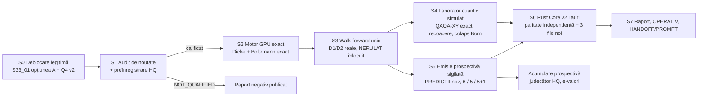

# Plan multi-sesiune QL649-HQ: Hamiltonianul exact al urnei, laboratorul cuantic simulat și emisia prospectivă sigilată

> [!IMPORTANT]
> **Nimic nu a fost rulat sau modificat.** Am făcut numai citiri și verificările read-only obligatorii. Planul așteaptă aprobarea ta.
> `positive_claims_allowed=false` rămâne valabil în fiecare etapă.

---

## 0. Ce am constatat (read-only, 2026-10-29 19:48Z)

| Verificare | Rezultat |
|---|---|
| Primul pas QL649 (`OPERATIV.md`): sha-uri, sonda S27 | `SONDA_RC=0`, `FAZA_2_DECONTARE_COMPLETA`, G1–G4 și T1–T5 OK, kernel `7.0.11`, Rust `c20fdcd2…` |
| `verifica_publicarea.py` (primul pas din AGENTS.md) | **FAIL**, `Immutable: …/prospectiv/540/REZULTATE_PROSPECTIVE.md`. Este exact incidentul cunoscut **S33_01** |
| GPU | RTX 5060 Laptop, 8 GiB VRAM, driver 595.104.02; 24 fire CPU, 15 GiB RAM |
| SSD extern | `./ssd_data` montat (`QL649_*`, `RUST_CORE_S18/S19`) |

**Ce înseamnă concret „decontare 3/3”:** cele 3 jocuri au fost **decontate**. Nu înseamnă 3 câștiguri. Prima decontare reală, cu ln E pe flux:
- 649: H1 −0.042, H3 −0.078
- 5/40: 0 / 0 (pariu inactiv)
- Joker: H1 +0.006, H3 −0.029

Pragul de explorare este ln 600 = 6.397. Aceste valori sunt exact ce prevede ipoteza nulă. Nu sunt nici succes, nici eșec.

**Unde stă de fapt „NERULAT”:** filele 4 și 5 cu această stare sunt în UI-ul **Streamlit** TU3 (`ui_tu3.py` L510–534: „SCI” și „Mașina Timpului”). În **Tauri** „Quantum Lab 649 · Rust Core”, fila 4 este *Paritate Rust↔Python*, fila 5 este *Inventar LIVE*, iar `NERULAT` nu apare deloc. Ambele UI se pot servi (vezi decizia D2). „NERULAT” dispare legitim numai prin mecanismul existent TU3-SR-R: o rulare reală sub protocol sigilat își scrie verdictul în locul casetei.

### Ce NU voi face, chiar dacă directiva o cere

| Cerere din directivă | De ce nu | Varianta profesională din plan |
|---|---|---|
| „Ignoră eșecurile formale / incidentele” | Ar invalida tot lanțul de probe: o probă rescrisă nu mai e probă | **S0**: deblocare *legitimă* prin amendament (opțiunea A pentru S33_01) și Q4 v2 |
| Scriere în `tribunal/LANT.jsonl` | Lanțul judecătorului este înghețat și conține emisii, nu rezultate | Un lanț nou, separat, `LANT_HQ.jsonl` |
| „Combinațiile cele mai stabile în fața entropiei” ca valoare predictivă | Dacă urna este uniformă, minimul de energie este zgomot | Testul de **peisaj nul** (§S1), care măsoară exact asta |
| `inplace=True` + SSD „ca să nu crape memoria” | Nu există presiune de memorie: 14M stări × float64 = 112 MB | Operațiile in-place rămân pentru marja de VRAM; SSD-ul servește la artefacte, memmap, checkpoint-uri și audit |
| „Colaps al funcției de undă” pe GPU | Calculul este clasic | Un colaps **real în sens matematic**: eșantionare Born dintr-un vector de stare simulat exact (§S4), cu sămânță commit-reveal |

---

## 1. Ideea centrală (originală, falsificabilă, calculabilă exact)

Biletele unui joc *k din n* sunt exact stările cu greutate Hamming k ale unui registru de n qubiți: **subspațiul Dicke**. Dimensiunile sunt mici pentru un GPU:

| Univers | Spațiul extragerii | Spațiul biletului | Vector de stare complex128 |
|---|---|---|---|
| 6/49 | C(49,6) = 13 983 816 | același | 224 MB |
| 5/40 (se extrag 6) | C(40,6) = 3 838 380 | C(40,5) = 658 008 | 61 MB |
| Joker 5/45 + 1/20 | C(45,5) × 20 = 24 435 180 | același | 391 MB |

De aici rezultă trei lucruri pe care proiectul nu le-a avut niciodată.

**A. Hamiltonian Ising exact al urnei (H-E).**

$$E(x)=\sum_i h_i x_i+\sum_{i<j}J_{ij}x_ix_j,\qquad |x|=k$$

Modelul se învață prin verosimilitate maximă **exactă**: funcția de partiție Z se calculează prin enumerare completă pe GPU, deci nu aproximăm nici gradientul, nici Z (mașină Boltzmann exactă cu 49 + 1176 parametri). „Varianta de energie minimă” capătă astfel un sens riguros: starea fundamentală. Scorul este log-verosimilitatea **comună** a extragerii,

$$\log\frac{P_\theta(\text{extragere})}{1/C(n,k)},$$

nu hit-urile ori Brier-ul marginal. Testele închise anterior au folosit în principal marginale.

**B. Ceasul Page–Wootters (H-PW): interpretarea onestă a lui Wheeler–DeWitt.**
În WDW (ĤΨ = 0) timpul extern lipsește. În mecanismul Page–Wootters, timpul *emerge* din corelația dintre un registru-ceas și sistem. Traducere testabilă: construim starea comună (ceas ⊗ bilet) din istoric. Ceasul poate fi ziua extragerii (joi/duminică), sezonul sau epoca arhivei; lista exactă se fixează în protocol, înainte de date. Dacă extragerile sunt i.i.d., starea este **produs**: entropia de încurcare (informația mutuală) dintre ceas și bilet este zero, iar starea fundamentală condiționată nu depinde de ceas. Este o predicție nulă precisă, deci falsificabilă.

**C. Testul de peisaj nul.**
Martorul care decide dacă minimul de energie înseamnă ceva. Pe GPU generăm ≥ 1000 de istorii sintetice uniforme, de aceeași lungime, și pe fiecare învățăm același Hamiltonian. Comparăm adâncimea stării fundamentale, gap-ul spectral și concentrarea Gibbs reale cu distribuția lor nulă. Dacă peisajul real nu este mai structurat decât cele nule, biletul de energie minimă este declarat **zgomot**, înainte de orice emisie.

---

## 2. Sesiunile

### S0 — Deblocare legitimă (prima sesiune, ~1 sesiune)
1. Mesajul tău intră în suplimentul de mesaje persistente, conform convenției.
2. **S33_01, opțiunea A (recomandată):** protocol și sigiliu *înainte* de cod pentru `verifica_publicarea_v2.py`, un fișier nou; cel vechi rămâne neatins. Registrele prospective vii se verifică ca **prefix append-only**: fiecare înregistrare veche, byte-identică, trebuie să existe în fișierul actual. Toate celelalte 4997 de verificări imuabile rămân stricte. Vechiul `DL_RC=1` rămâne în arhivă ca FAIL.
3. **Q4 v2 (S33_02):** verificator nou care citește `USER_INVOCATION_ID`, cu protocol și sigiliu înainte de rulare. Q4 S24 rămâne FAIL formal.
4. Criteriul de ieșire: `DL_RC_v2=0` și Q4 v2 PASS, ambele în jurnal, fără nicio probă rescrisă. Ținta este ca fereastra C1 de duminică (13:36–13:57Z) să nu mai pice pe aceste două puncte.

### S1 — Audit de noutate și preînregistrare (~1 sesiune, fără calcule pe date)
- Compar H-E și H-PW cu cele ~30 de familii închise, în special transfer_perechi, MI, ordine_contextuala, memorie_*, sincronizare_intervale și accesibilitate_temporala, plus coliziunile pe perechi DL/PG. **Dacă H-E se reduce la o familie închisă, o declar `NOT_QUALIFIED` și o public.** Nu o redenumesc.
- Martor de informație: istorii-fixture cu marginale și perechi identice, dar triplete diferite. Arată ce vede modelul comun și nu văd marginalele.
- Martor de decizie: fixture unde biletul de energie minimă diferă de B, I și U.
- Pragurile se fixează înainte de cod: aceleași 6 porți ca până acum (hits față de B/I/U, exces ≥ .20, log-scor) plus porțile noi.
  - **G-NULL:** peisajul real față de peisajul nul, cu cuantila fixată în avans.
  - **G-PW:** informația mutuală ceas↔bilet, prin permutare, cu Bonferroni pe numărul de ceasuri.
  - Prior L2 ales numai prin validare interioară leave-future-out, niciodată pe ținte.

### S2 — Motorul GPU exact (~1–2 sesiuni)
- PyTorch CUDA. Rang și derang în sistemul combinatorial de numerație direct pe GPU. Enumerare completă pentru toate trei universurile.
- Log Z în float64 prin logsumexp. *Notă onestă:* RTX 5060 are FP64 la circa 1/64 din FP32. Vom măsura costul; calculul încape oricum: pentru 6/49, circa 21 × 14M gather-uri pe pas.
- Operații in-place. Memmap pe `./ssd_data/QL649_HQ/` pentru tabele de energie, checkpoint-uri și jurnale, după garda de montare de tip SM1.
- **Certificare:** pe fixture-uri mici (n ≤ 10), GPU-ul trebuie să coincidă exact cu `fractions.Fraction` pe CPU (Z, momente, argmin). Testele de invarianță la permutarea etichetelor trebuie să treacă.

### S3 — Experimentul walk-forward unic (~1 sesiune, o singură rulare)
- Pentru fiecare țintă t: învățare numai pe extragerile < t, cu warm-start. Calculăm log P(extragere_t), biletul de energie minimă și hit-urile față de B, I și U. Costul estimat este circa 2500 de ținte × 50 de pași.
- Verificatorul este separat, nu importă modelul și recalculează pe CPU pe un eșantion sigilat de ținte.
- **Rezultatul se publică oricare ar fi.** Verdictele D1/D2 înlocuiesc „NERULAT” în filele 4/5 prin mecanismul TU3-SR-R. Ecranul va arăta verdictul real, foarte probabil negativ, nu un placeholder deblocat artificial.

### S4 — Laboratorul cuantic simulat (~2 sesiuni; aici „cuantic” are acoperire matematică exactă)
- **QAOA cu mixer XY de graf complet, în subspațiul Dicke, simulat exact pe GPU.** Acest mixer este *exact* matricea de adiacență a grafului Johnson J(n,k). Spectrul lui se cunoaște în formă închisă:

$$\theta_m=(k-m)(n-k-m)-m,\quad m=0..k$$

  Prin urmare $e^{-i\beta A}=\sum_m e^{-i\beta\theta_m}E_m$, cu proiectorii Lagrange $E_m=\prod_{l\ne m}\frac{A-\theta_l}{\theta_m-\theta_l}$. Ajung **k matvec-uri exacte** pe aplicare: 6 pentru 6/49, fiecare stare având 258 de vecini. Nu există trunchiere Trotter sau Krylov.
- Recoacere adiabatică: gap-ul minim de-a lungul drumului (Lanczos) și probabilitatea stării fundamentale.
- **Colaps Born verificabil:** sămânța este `SHA-256(sha protocol ‖ sha arhivă ‖ data țintă)`, cu commit înainte și reveal după.
- Fiecare rezultat se verifică față de starea fundamentală exactă din enumerare. *Onest:* este o simulare clasică. Enumerarea directă este mai rapidă și nu există avantaj cuantic. Valoarea stă în **benchmark-ul exact al unui algoritm cuantic pe Hamiltonieni reali**, unde adevărul este cunoscut, ceea ce rar se poate face.

### S5 — Emisia prospectivă sigilată a celor 3 variante (~1 sesiune, apoi automat)
- `PREDICTII.npz` conține biletele 6/49, 5/40 și 5/45+J, coeficienții (h, J), log Z, energiile, gap-ul și sha-ul arhivei. Alături: `PREDICTII_SIGILIU.json` și lanțul nou `LANT_HQ.jsonl` (hash înlănțuit, 0444). Totul se emite **înainte de cutoff-ul de 14:00Z**.
- Un judecător HQ separat, cu protocolul lui. E-valoarea este raportul de verosimilitate,

$$E_t=\frac{P_\theta(\text{extragere}_t)}{1/C(n,k)},$$

  care sub H0 (uniform i.i.d.) este martingală de test exactă, cu corecție pentru numărul de fluxuri. Judecătorul TU4 înghețat și M = 6 ale lui rămân neatinse.
- **Realism**, cu numărul de extrageri până la ln 600 dat de

$$n\approx\frac{\ln 600}{\mathrm{KL}}$$

| KL adevărat pe extragere | Extrageri până la ln E = ln 600 | Durată (~104 extrageri/an) |
|---|---|---|
| 0.01 nats | ~640 | ~6 ani |
| 0.001 nats | ~6 400 | ~61 de ani |
| 0 (urnă uniformă) | ∞ | — |

### S6 — Rust Core v2 (Tauri), în paralel cu S5 (~2 sesiuni)
- **Crate nou, versionat** (de exemplu `rust_core_hq/`). Sursele 0444 și binarul `c20fdcd2…` rămân neatinse, ca sonda S27 (G2/G3) să rămână OK.
- **Paritate independentă:** Rust recalculează toate cele 14M energii pe CPU (AVX2 + rayon) din coeficienții exportați și cere același argmin, același log Z (cu toleranță declarată) și același sha.
- File noi:
  - **Peisaj energetic:** histograma celor 14M energii, starea fundamentală, gap-ul, poziția față de peisajul nul.
  - **Laborator QAOA:** probabilitatea stării fundamentale în funcție de adâncime și curba gap-ului.
  - **Emisii HQ:** cele 3 variante, lanțul SHA-256, starea verificării și traiectoria ln E.
- Mențiunea `positive_claims_allowed = false` rămâne vizibilă în antet.

### S7 — Închiderea (~1 sesiune)
Raport final cu negativele incluse, actualizarea `OPERATIV.md`, perechea HANDOFF/PROMPT cu același UTC, mesajele persistente în anexă, verificări și `./dev-git status`, fără add/commit.

---

## 3. Calendar și riscuri

- **Duminică, 1 noiembrie:** emisia automată TU4 rulează singură. Fereastra C1 este 13:36–13:57Z. Fluxul HQ **nu** se grăbește pentru 1 noiembrie. Prima emisie HQ se face la prima țintă după ce S1–S3 trec, cu calitate înaintea vitezei.
- Riscuri: H-E poate ieși ne-distinctă (atunci `NOT_QUALIFIED`); FP64 lent pe GPU (soluție: verificare mixtă, cu FP32 compensat și FP64 la final); apariția unui incident nou (se declară, nu se ascunde).

## 4. Deciziile tale

1. **S33_01:** A (recomandat), B sau C?
2. **Filele 4/5:** cele din Streamlit TU3 (unde există „NERULAT”), filele noi din Tauri v2, sau **ambele** (recomandat)?
3. Aprobi un **flux prospectiv HQ separat**, cu judecătorul lui, fără să atingem judecătorul TU4 înghețat?
4. Aprobi testul de peisaj nul cu istorii sintetice uniforme? Este un motiv nou față de interdicția de a reface cercetarea sintetică.
5. Ordinea: S0 → S1 → S2 → S3, apoi S4/S5/S6. Sau vrei laboratorul cuantic (S4) mai devreme, ca demonstrație?
