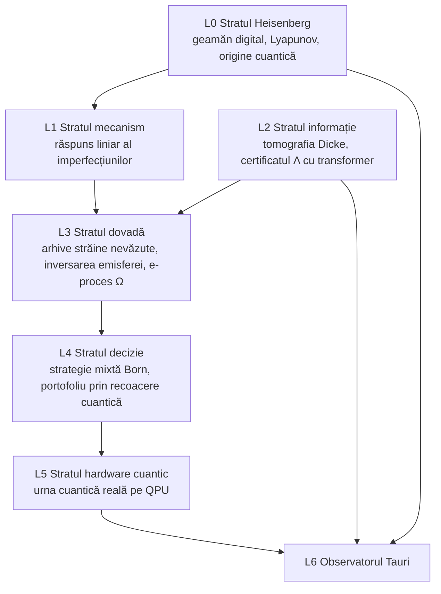

# Plan v3 — QL-Ψ „Urna ca sistem cuantic”: de la Heisenberg la QPU, strat cu strat

> [!IMPORTANT]
> Nimic nu a fost rulat. Planul așteaptă aprobarea ta. `positive_claims_allowed=false`.
> Regula de onestitate rămâne fermă: **„magie/SF” înseamnă calcul de frontieră, real și verificabil**, nu metafore lipite peste modele vechi. Proiectul a încercat deja varianta cu metafore: PL649 „Planck/Higgs” și QL649 „Amplituhedron” au ieșit 0/6.

## Ideea care sparge cadrul convențional

Toate cele 40 de piste anterioare au tratat urna ca pe un **șir de numere**. v3 o tratează ca pe ceea ce este fizic: **un sistem haotic de 49 de bile, care amplifică fluctuațiile cuantice până la scară macroscopică**. Matematic, extragerea uniformă este exact o **stare Dicke** de 49 de qubiți măsurată în baza computațională.

Din aceste două fapte rezultă un program pe straturi, de la constanta lui Planck până la un procesor cuantic real.

---

## L0 — Certificatul Heisenberg al urnei *(piesa centrală, originală)*

- **Geamăn digital DEM pe GPU** (NVIDIA Warp sau CUDA prin PyTorch): 49 de sfere cu masa, raza, coeficientul de restituție și frecarea măsurabile, într-un tambur gravitațional și într-o variantă cu aer. Geometria exactă a mașinii RO nu este certificată, așa că rezultatele se dau pe **o familie parametrică**, ca intervale.
- **Exponentul Lyapunov λ** se obține din perechi de traiectorii vecine, cu renormalizare Benettin.
- **Orizontul Heisenberg:**

$$T_H=\frac{1}{\lambda}\ln\frac{\Delta x_{\text{macro}}}{\Delta x_{\text{cuantic}}}$$

  Aici Δx_cuantic este incertitudinea minimă a poziției bilei (pachet de undă cu masă m, în timpul de coerență relevant), iar Δx_macro este scara care decide bila extrasă.
- **Ce se demonstrează:** dacă T_H ≪ durata amestecului (secunde față de zeci de secunde), atunci **rezultatul extragerii este de origine cuantică**, în sensul Albrecht–Phillips (2014). Nicio informație clasică, oricât de completă, nici măcar un demon Laplace, nu o poate prezice. Este „Quantum Limit”-ul la propriu, calculat, nu metaforic.
- **Precedente:** Albrecht & Phillips, *Phys. Rev. D* 90 (2014); Diaconis–Holmes–Montgomery, *SIAM Review* (2007, moneda); Benettin et al. (1980); Zurek, despre haos și decoerență. Contribuția proprie: aplicarea pe urne de loterie, cu certificat numeric și intervale.

## L1 — Ce supraviețuiește haosului: răspuns liniar

Haosul șterge condițiile inițiale, dar **nu** șterge imperfecțiunile statice: masa vopselei de pe cifre (GL649), raza, uzura, temperatura (SE649). Aceste imperfecțiuni produc bias-uri marginale mici.

- **Metoda:** simulez imperfecțiuni *exagerate* (de 10–100 de ori), pentru care bias-ul se poate măsura cu puține simulări, apoi extrapolez în regim liniar (teoria răspunsului liniar, cu verificarea liniarității pe 3 amplitudini).
- **Rezultatul:** o **predicție fizică a priori** pentru mărimea bias-ului „cerneală grea”, în nați pe extragere, obținută **fără să ating arhiva RO**. Ea devine prior fixat pentru testul confirmator L3. Este prima pistă a proiectului în care ipoteza vine din fizică, nu din date.

## L2 — Tomografia urnei și certificatul informațional

- **Urna ca stare Dicke |D⁴⁹₆⟩.** Antrenez o **mașină Born MPS** (Han et al., *PRX* 2018) pe extrageri și compar **spectrul de încurcare** pe tăieturi cu spectrul *exact* al stării Dicke. Pentru o tăietură cu n_A qubiți, coeficienții Schmidt sunt hipergeometrici:

$$\lambda_j=\frac{\binom{n_A}{j}\binom{n-n_A}{k-j}}{\binom{n}{k}}$$

  Orice abatere înseamnă structură de mulți corpi. Este un test pe toate ordinele de corelație simultan, nu doar pe perechi; PG s-a oprit la 2 corpi. Diagnosticul este și vizual: „amprenta de încurcare a urnei”.
- **Certificatul Λ.** O mixtură universală, care acum include un **transformer instruit prequential** pe GPU (Delétang et al., „Language Modeling Is Compression”, ICLR 2024), dă un plafon *determinist* al câștigului pe care l-ar fi putut obține orice predictor din clasă, chiar ales după ce cunoaștem rezultatele. Plafonul se convertește apoi în lei prin `ceiling.py`.

## L3 — Dovada pe date nevăzute

- **Arhive publice 1..49 nevăzute** (estimativ Germania, Polonia, Canada; inventarul exact se face în sesiune) se testează **o singură dată**, cu priorul fizic din L1 și predictorii GL/SE înghețați.
- **Inversarea emisferei:** un efect termic trebuie să-și schimbe semnul pe arhivele din sud (Australia, Africa de Sud). Este un control natural de falsificare.
- **Ω:** e-proces universal prospectiv pe cele 3 jocuri, cu judecător separat. Judecătorul TU4 rămâne înghețat.

## L4 — Decizia: colaps cu rost și portofoliu cuantic

- **Strategia mixtă Born** peste biletele ε-aproape optime după câștigul așteptat. Într-o loterie unde premiul se împarte, un bilet „optim” publicat identic pentru toți se autoanulează. Așa se obțin **cele 3 variante (6 / 5 / 5+1)**, cu commit-reveal SHA-256 înainte de cutoff.
- **Portofoliul de K bilete** este o problemă QUBO reală: maximizează câștigul așteptat și minimizează suprapunerile, ca la „roțile” de loterie și designurile de acoperire. Îl rezolv prin **recoacere cuantică simulată** (Monte Carlo pe integrala de drum, Santoro et al., *Science* 2002) pe GPU și îl verific față de optimul exact acolo unde se poate calcula.
- Eticheta rămâne onestă: șansa de câștig este exact cea uniformă; doar valoarea condiționată de câștig se optimizează.

## L5 — Urna cuantică reală *(opțional; are nevoie de decizia ta)*

- **Simulat pe GPU:** prepararea stării Dicke |D⁴⁹₆⟩ prin circuitul Bärtschi–Eidenbenz (2019), cu QAOA-XY și Grover-Dicke în subspațiul de 14M amplitudini. Mixerul este aplicat stabil prin matricele Eberlein ale schemei Johnson.
- **Pe QPU real**, de exemplu IBM, cu cont deschis de tine: aceeași stare Dicke se prepară și se măsoară. Urna cuantică produce bilete. Apoi **compar urna cuantică cu urna fizică RO** prin aceleași teste L2 (spectru de încurcare, Λ). Zgomotul hardware devine el însuși un obiect de măsurat.
- **Opțiunea de frontieră:** aleatoriu **certificat** (protocolul Liu et al., *Nature* 2025) ca sursă a sămânței pentru colapsul Born din L4. Colapsul ar deveni astfel *fizic cuantic*, nu simulat.

## L6 — Observatorul (Tauri v2, crate nou; cel sigilat rămâne neatins)

File noi:
- **Orizontul Heisenberg:** λ, T_H și simularea bilelor.
- **Răspunsul imperfecțiunilor.**
- **Amprenta de încurcare:** spectrul real față de spectrul Dicke.
- **Contorul Λ** în nați și lei.
- **Harta Γ** pe țări, cu emisfere.
- **Traiectoria Ω.**
- **Cele 3 variante sigilate.**
- **Laboratorul QPU.**

Rust recalculează independent orice număr afișat. Filele 4/5 din Streamlit primesc verdicte reale prin mecanismul TU3-SR-R.

---

## Sesiunile

| S | Livrabil | Acceptare | Oprire |
|---|---|---|---|
| S0 | Deblocare legitimă: S33_01 opțiunea A și Q4 v2, cu protocol înainte de cod | DL_RC_v2 = 0, Q4 v2 PASS; vechile FAIL păstrate | o probă veche atinsă ⇒ STOP |
| S1 | Protocol L0/L1: fizica, parametrii, criteriile Lyapunov, verificarea liniarității | conservarea energiei < 10⁻⁶ fără disipare; test pe biliard Sinai cu λ cunoscut | integratorul nu conservă ⇒ refacere |
| S2–S3 | Geamănul DEM, λ, T_H, certificatul Heisenberg | intervalul T_H pe familia de mașini, reproductibil din seed | T_H nu e ≪ amestecul ⇒ publicat ca atare |
| S4 | L1: răspuns liniar (cerneală, rază, temperatură) | liniaritatea confirmată pe 3 amplitudini | neliniar ⇒ fără prior, publicat |
| S5 | L2: mașina Born MPS + tomografia Dicke | spectrul exact reprodus pe date sintetice uniforme | — |
| S6 | L2: certificatul Λ (CTW, Fixed-Share, transformer) | regret verificat exact în Q pe n ≤ 10 | o inegalitate încălcată ⇒ respins |
| S7 | L4: colaps Born, prima emisie sigilată a celor 3 variante | sigilată înainte de cutoff; verificator separat PASS | cutoff ratat ⇒ ținta următoare |
| S8 | L4: portofoliu QUBO prin recoacere cuantică simulată | optimul exact regăsit pe instanțe mici | — |
| S9 | L3: inventarul arhivelor străine (inventariere, nu experiment) | sha, URL, dată; dublă sursă | fără surse ⇒ Γ NOT_FEASIBLE |
| S10 | L3: testul confirmator unic, cu emisfere | protocol sigilat înainte de S9 | rezultatul se publică oricum |
| S11 | L5: Dicke/QAOA/Grover simulat; QPU opțional | eroare < 10⁻¹⁰ față de Aer (n ≤ 14) | — |
| S12 | L6: Observatorul Tauri v2 | paritate Rust pe toate numerele afișate | divergență ⇒ nu se afișează |
| S13 | Raport final, OPERATIV.md, HANDOFF/PROMPT | verificări PASS | — |

**Buget onest de calcul.** λ și T_H se obțin în minute pe RTX 5060. Bias-urile mici direct ar costa zile de GPU; de aceea folosesc răspunsul liniar. Mașina Born MPS și transformerul încap ușor în 8 GiB. Compatibilitatea Warp cu arhitectura Blackwell (sm_120) se verifică în S1; alternativa este un kernel PyTorch propriu.

## Deciziile tale

1. **S33_01:** opțiunea A?
2. **L3:** aprobi descărcarea de arhive publice străine?
3. **L5:** rămânem doar la simulare (recomandat la început) sau deschizi tu un cont QPU pentru urna cuantică reală?
4. **Ordinea:** S0 → L0/L1 (Heisenberg) → L2 → L4 → L3 → L5 → L6 (recomandată)?
5. Fluxurile prospective noi Ω și V, cu judecători separați: aprobi?
6. Vrei ca auditul AI să primească și v1/v2, ca să vadă evoluția, sau doar v3?
