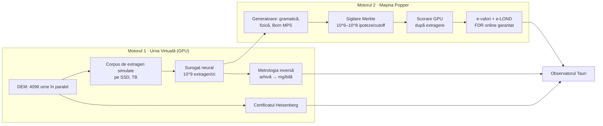

# Plan v4 — QL-Ξ: două motoare care nu există împreună nicăieri în proiect, la puterea maximă a laptopului

> [!IMPORTANT]
> Nimic nu a fost rulat. Planul așteaptă aprobarea ta. `positive_claims_allowed=false`. Calculul este clasic, cu excepția stratului QPU opțional.
> **Despre noutate, onest:** o căutare rapidă arată că simulări DEM ale mașinilor de loterie există în literatură. Noutatea revendicabilă stă în **combinația certificată** de mai jos, nu în piese izolate. S1 include un audit bibliografic, înainte de orice afirmație de noutate.

---

## Ideea: o fabrică de ipoteze falsificabile care rulează pe o urnă virtuală

Până acum proiectul a testat **manual circa 40 de ipoteze**. Fiecare a cerut o zi de protocol și a ieșit 0/6.

v4 construiește două motoare care schimbă scara cu **6–7 ordine de mărime** și o fac cu garanții formale:

### Motorul 1 — Urna Virtuală

1. **DEM pe GPU la scară:** 4096 de urne simulate simultan, cu 49 de bile, contacte soft-sphere, frecare și rotație, în variantele tambur și aer. Ținta este circa 10⁶ extrageri complete pe zi pe RTX 5060; o verific în S2 cu benchmark, nu o promit.
2. **Corpusul pe SSD:** traiectorii eșantionate și rezultate, de ordinul sutelor de GB până la 1 TB. Pe el antrenez un **surogat neural** (GNN sau operator neural) care ajunge la circa 10⁹ extrageri pe zi. Surogatul se calibrează permanent față de DEM-ul complet.
3. **Certificatul Heisenberg:** exponentul Lyapunov λ și orizontul T_H = λ⁻¹ ln(Δx_macro/Δx_cuantic). Dacă T_H ≪ timpul de amestec, extragerea este **de origine cuantică** (Albrecht & Phillips, 2014). Rezultatul vine ca intervale pe familia de mașini, pentru că geometria mașinii RO nu este certificată.
4. **Metrologia inversă, arhivă → miligrame.** Matricea de răspuns R se obține prin răspuns liniar pe geamăn. Inversarea bayesiană a frecvențelor istorice dă, **pentru fiecare bilă, o limită superioară a abaterii de masă, în mg**. Arhiva devine un instrument de măsură, cu sensibilitate calculată. Concluzia probabilă, dacă urna e corectă, este de tipul: „arhiva nu poate detecta abateri sub X mg”, iar X este rezultatul publicat.

### Motorul 2 — Mașina Popper (piesa centrală)

- **Generatoarele de ipoteze:**
  - o **gramatică** de predictori: ferestre, intervale, perechi, glife, calendar, transfer între jocuri, compoziții;
  - **eșantioane din geamănul fizic**: tipare de imperfecțiune, fiecare cu vectorul de bias prezis;
  - **mașini Born MPS** cu dimensiuni de legătură aleatoare;
  - semințe de ansambluri neurale.
- **Sigilarea:** înainte de fiecare cutoff, distribuțiile predictive ale a **10⁶–10⁸ ipoteze** se sigilează într-un **arbore Merkle**. Rădăcina se publică în `LANT_POPPER.jsonl` (append-only, 0444), iar frunzele merg pe SSD.
- **Scorarea:** după extragere, GPU-ul calculează pentru fiecare ipoteză e-valoarea

$$e_h=\frac{q_h(\text{extragere})}{u(\text{extragere})}$$

  și le acumulează în timp.
- **Controlul erorilor:** **e-LOND** (Xu & Ramdas, 2024) garantează **FDR ≤ 5% pe un flux nelimitat de ipoteze**, chiar sub dependență arbitrară.
- **De ce contează:** este prima unealtă a proiectului care poate spune, cu garanție matematică, una din două:
  - „am testat prospectiv N miliarde de ipoteze sigilate și nicio descoperire nu supraviețuiește la FDR 5%”;
  - sau numește exact ipoteza care a supraviețuit.
- **Regulile proiectului:** verdictele celor 40 de familii închise rămân neatinse. Popper este o ipoteză nouă, *de clasă* („există structură în G”), testată **numai prospectiv**.

### Stratul cuantic

- **Tomografia Dicke:** spectrul de încurcare al mașinilor Born comparat cu spectrul hipergeometric exact al lui |D⁴⁹₆⟩.
- **Urna cuantică pe QPU:** opțional, numai cu contul tău.
- **Mixerul XY** al grafului Johnson, aplicat stabil prin matricele Eberlein, pentru QAOA și Grover-Dicke simulate exact (14M amplitudini).

### Decizia și produsul

- **Cele 3 variante (6 / 5 / 5+1):** strategie mixtă Born peste biletele aproape optime după câștigul așteptat. Un bilet „optim” publicat identic pentru toți se autoanulează într-o loterie unde premiul se împarte. Alegerea se face prin commit-reveal SHA-256 înainte de cutoff.
- **Eticheta:** șansa de câștig este exact cea uniformă.
- **Certificatele afișate:** Λ (plafonul predictibilității, în lei), Heisenberg și metrologie.

---

## Harta resurselor (folosire maximă, fără praguri termice proprii; protecțiile hardware/OS rămân)

| Resursă | Folosire | Țintă în campanii |
|---|---|---|
| **RTX 5060, 8 GB** | kernel-uri DEM batch (Warp/Triton), surogat, scorarea Popper, Born MPS, vectori Dicke | GPU ~95%, VRAM 6.5–7.5 GB, cu pipeline dublu (calcul + transfer asincron) |
| **CPU, 24 fire** | arbori Merkle (SHA-256 paralel în Rust + rayon), verificatorul Rust independent, CTW/Λ, decodarea corpusului | 20–24 fire în paralel cu GPU-ul |
| **RAM, 15 GiB** | buffere inelare pinned pentru streaming SSD ↔ GPU | ≤ 12–13 GiB, fără swap |
| **SSD, 1.8 TB** | corpusul DEM, frunzele Merkle, checkpoint-uri, memmap | 1–1.5 TB alocați progresiv, cu garda de montare și spațiu de siguranță |

Notă de regulă: agentul **nu creează timere sau joburi autonome**. Campaniile lungi rulează în sesiune, iar ciclurile prospective se pornesc manual sau prin timere instalate de tine.

## Sesiunile

| S | Livrabil | Acceptare | Oprire |
|---|---|---|---|
| S0 | Deblocare legitimă: S33_01 opțiunea A și Q4 v2 | DL_RC_v2 = 0, Q4 v2 PASS, vechile FAIL păstrate | probă veche atinsă ⇒ STOP |
| S1 | Audit bibliografic și protocoalele M1/M2, sigilate | precedente atribuite; praguri fixate | dacă există deja o implementare completă ⇒ repoziționare declarată |
| S2 | Kernel DEM și benchmark | energie conservată < 10⁻⁶ fără disipare; biliard Sinai cu λ cunoscut; extrageri/zi măsurate | sub 10⁵ extrageri/zi ⇒ plan de surogat revizuit |
| S3 | Certificatul Heisenberg | intervalul T_H, reproductibil din seed | se publică oricum |
| S4–S5 | Corpusul pe SSD și surogatul | eroarea surogatului față de DEM sub pragul fixat | peste prag ⇒ fără surogat |
| S6 | Metrologia inversă (mg/bilă) | calibrare pe urne sintetice cu mase cunoscute | nu recuperează masele cunoscute ⇒ respins |
| S7–S8 | Mașina Popper: generatoare, Merkle, scorare, e-LOND | FDR verificat empiric ≤ 5% pe 10³ fluxuri sintetice nule | depășire ⇒ STOP |
| S9 | Primul ciclu prospectiv Popper și cele 3 variante sigilate | sigilate înainte de cutoff; verificator Rust PASS | cutoff ratat ⇒ ținta următoare |
| S10 | Λ și tomografia Dicke | regret verificat exact în Q; spectru Dicke reprodus | — |
| S11 | Arhive străine nevăzute (dacă aprobi), cu inversarea emisferei | proveniență cu sha; un singur test | fără surse ⇒ NOT_FEASIBLE |
| S12 | QAOA/Grover-Dicke; QPU opțional | eroare < 10⁻¹⁰ față de Aer (n ≤ 14) | — |
| S13 | Observatorul Tauri v2 (crate nou) | paritate Rust pe tot ce se afișează | divergență ⇒ nu se afișează |
| S14 | Raport, OPERATIV.md, HANDOFF/PROMPT | verificări PASS | — |

## Deciziile tale

1. **S33_01:** opțiunea A?
2. **SSD:** pot aloca **până la 1.5 TB** pe `./ssd_data/QL_XI/`?
3. **Ciclurile prospective Popper:** le pornești manual în sesiuni sau vrei să-ți pregătesc un timer *pe care îl instalezi tu*?
4. **Arhive străine:** aprobi descărcarea arhivelor publice?
5. **QPU real:** acum, mai târziu sau niciodată?
6. **Ordinea:** S0 → M1 (S2–S6) → M2 (S7–S9) → rest (recomandată), sau Popper mai întâi?
