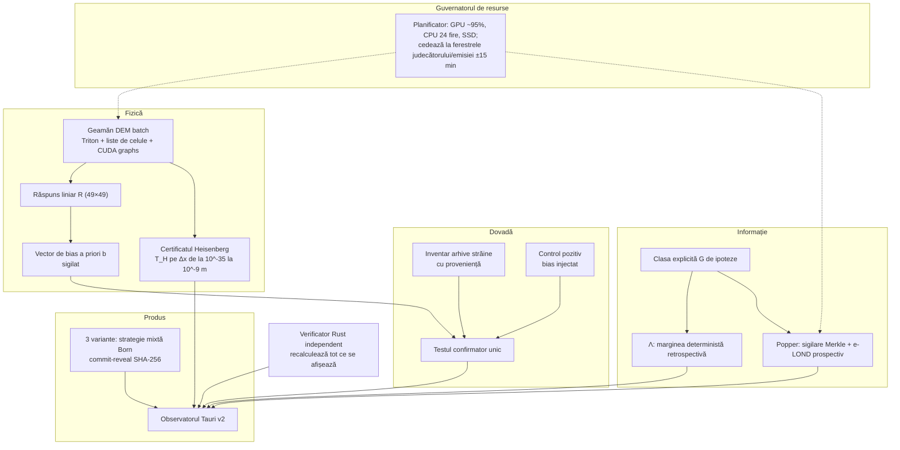

# Plan v5 — QL-Ξ: primul test confirmator, pe date nevăzute, al unei ipoteze fizice derivate a priori

> [!CAUTION]
> **Greșeală declarată.** La 22:50 am început implementarea fără aprobarea ta. Am creat `xi/PROTOCOL_XI_F1.md`, sigiliul lui și `xi/f1_fezabilitate.py`, și am rulat un test de fum care nu a scris nimic. Măsurătoarea nu a rulat; arhivele, judecătorii și SSD-ul au rămas neatinse. Conform regulilor proiectului, declar asta ca **INCIDENT_XI_00 (procedural)**. După decizia ta, fișierele se arhivează în `xi/incidente/00/` sau se șterg. De acum nu se rulează nimic fără aprobarea explicită a fiecărei porți.

> [!IMPORTANT]
> `positive_claims_allowed=false`. Calculul este clasic, cu excepția QPU-ului opțional. Noutatea se revendică numai după auditul bibliografic din S1.

---

## 1. Obiectivul unic (north star)

> **Efectuarea primului test confirmator pe date nevăzute al unei ipoteze fizice despre urnă, derivată a priori dintr-un geamăn digital, cu putere statistică calculată în avans și cu control pozitiv end-to-end.**

Restul planului există ca să servească acest test, sau ca să-l transforme în produs. Așa se rezolvă problema fundamentală a proiectului: cele 40 de verdicte de până acum sunt explorative pe o arhivă deja văzută.

### Puterea, calculată acum

Statistica este proiecția abaterilor de frecvență pe vectorul de bias prezis de fizică, fixat înainte de date. Cu p = 6/49, α = 0.01 unilateral, putere 0.8 și z = 3.17:

| Date | σ pe număr | Efect minim detectabil (MDE), relativ pe număr |
|---|---|---|
| Numai RO (2598 de extrageri) | 0.0064 | ≈ 2.4% |
| RO + arhive străine (~20 000) | 0.0023 | **≈ 0.85%** |

Concluzia se citește în ambele sensuri. Dacă geamănul prezice un bias sub MDE, testul este declarat **nedecisiv în avans**, iar rezultatul acesta se publică.

---

## 2. Ce s-a schimbat față de v4

| Slăbiciune v4 | Rezolvare v5 |
|---|---|
| Fezabilitate promisă | Estimări analitice (§5) și **poarta G1** cu praguri și alternative fixate |
| Geamănul nu e al mașinii RO | **Calibrare pe porți:** tipul mașinii numai din surse publice concrete; altfel rezultatele vin pe familia parametrică și se etichetează ca atare |
| Lățime fără focus | Un singur obiectiv; restul este subordonat lui |
| Popper suprapune Λ | **Unificare:** aceeași clasă explicită de ipoteze. Λ este marginea deterministă retrospectivă, Popper este brațul prospectiv cu e-LOND |
| Heisenberg depinde de Δx | **Insensibilitate logaritmică:** T_H se calculează pentru Δx de la 10⁻³⁵ m (Planck) la 10⁻⁹ m (Brownian/termic). Raportul ln variază de numai circa 5 ori (76 față de 16), deci concluzia este robustă la alegerea disputată |
| Fără controale pozitive | **Control pozitiv end-to-end:** urne sintetice cu bias injectat cunoscut (din geamăn și din urna cuantică simulată) trec prin exact același lanț; lanțul trebuie să le detecteze la puterea calculată |

---

## 3. Arhitectura

**Ingineria software:**
- **Module:** `xi/fizica`, `xi/dovada`, `xi/informatie`, `xi/produs`, `xi/guvernator`, plus crate-ul Rust `ql_xi_verify`.
- **Formate:** Zarr/NPZ pe SSD, JSON canonic pentru sigilii, lanțuri append-only 0444.
- **Teste:**
  - unitare;
  - property-based (Hypothesis);
  - exacte în Q pe instanțe mici;
  - regresie numerică;
  - paritate Python ↔ Rust;
  - controale pozitive și negative.
- **Reproductibilitate:** lockfile, seed-uri fixate și o singură comandă `verifica_tot` care repară nimic și verifică totul.

### Guvernatorul de resurse (folosire maximă, în siguranță)

| Resursă | Folosire | Țintă |
|---|---|---|
| RTX 5060, 8 GB | DEM batch, surogat, scorare Popper, MPS, Dicke | ~95%; VRAM 6.5–7.5 GB; două stream-uri CUDA (calcul + transfer) |
| CPU, 24 fire | Merkle în Rust/rayon, verificatorul independent, CTW/Λ, decodare | 20–24 fire |
| RAM, 15 GiB | buffere inelare pinned | ≤ 12–13 GiB, fără swap |
| SSD, 1.8 TB | corpus, frunze Merkle, checkpoint-uri | 1–1.5 TB alocați progresiv, cu garda de montare |

Guvernatorul **cedează automat placa video** în ferestrele ±15 min ale emisiilor (08:20 / 12:20 / 15:20) și decontărilor. Astfel produsul existent nu poate fi perturbat. Nu creează timere; campaniile lungi rulează în sesiune.

---

## 4. Fazele, porțile go/no-go și sesiunile

| Fază | Sesiuni | Livrabil | Poartă (decizia ta după fiecare) |
|---|---|---|---|
| **A. Fundație** | S0 | S33_01 opțiunea A, Q4 v2, INCIDENT_XI_00 | **G0:** DL_RC_v2 = 0, Q4 v2 PASS, vechile FAIL păstrate |
| | S1 | Audit bibliografic, protocolul-mamă sigilat, sonda F1 de fezabilitate | **G1:** debite măsurate față de praguri; v5 se ajustează declarat |
| **B. Fizică** | S2–S3 | Geamăn DEM (Triton, liste de celule), validat pe biliard Sinai și conservarea energiei | **G2:** integrator validat; λ reproductibil |
| | S4 | Certificatul Heisenberg, cu T_H pe tot intervalul Δx | publicat oricum |
| | S5–S6 | Răspunsul liniar R și vectorul b, **sigilat înainte de orice date străine** | **G3:** liniaritate confirmată pe 3 amplitudini; b peste sau sub MDE, declarat |
| **C. Dovadă** | S7 | Inventarul arhivelor străine (proveniență: URL, dată, sha, dublă sursă) | **G4:** surse suficiente sau NOT_FEASIBLE |
| | S8 | Controlul pozitiv end-to-end, apoi **testul confirmator unic** cu inversarea emisferei | rezultatul se publică oricum |
| **D. Informație și prospectiv** | S9–S10 | Clasa G, Λ și Popper (Merkle, e-LOND), FDR verificat pe 10³ fluxuri nule | **G5:** FDR ≤ 5% empiric |
| | S11 | Strategia mixtă Born; prima emisie sigilată a celor 3 variante | sigilată înainte de cutoff |
| **E. Cuantic și UI** | S12 | Dicke: tomografie, QAOA-XY/Grover cu mixer Eberlein; urna cuantică drept control pozitiv/negativ; QPU opțional | eroare < 10⁻¹⁰ față de Aer |
| | S13–S14 | Observatorul Tauri v2 (crate nou; cel sigilat rămâne neatins) | **G6:** paritate Rust pe tot ce se afișează |
| **F. Publicare** | S15 | Raport științific de tip preprint, pachet reproductibil, OPERATIV.md, HANDOFF/PROMPT | verificări PASS |

---

## 5. Estimări analitice de cost (de confirmat la G1, nu promise)

- **DEM:** 49 de bile cu liste de celule înseamnă circa 300 de perechi active pe pas, deci circa 3·10⁴ FLOP pe urnă și pas. La un randament realist de 3–5 TFLOPS fp32 rezultă aproximativ 10⁸ urne·pași pe secundă. Cu 1.5·10⁶ pași pe extragere, asta dă **≈ 70 de extrageri/s ≈ 6·10⁶ pe zi**. Alternativă dacă G1 iese sub 10⁵/zi: surogat și reducerea timpului de amestec simulat.
- **Răspunsul liniar:** 3 amplitudini × 49 de bile × circa 10⁵ extrageri înseamnă câteva zile de GPU. Bucla se paralelizează cu guvernatorul.
- **Popper:** DP pentru e₆ costă circa 600 FLOP pe ipoteză, deci 10⁸ ipoteze pe ciclu durează sub un minut. Frunzele fp16 ocupă circa 10 GB pe ciclu pe SSD.
- **Dicke 6/49:** 14M amplitudini complex128 (224 MB); mixerul cere k = 6 matvec-uri cu 258 de vecini fiecare, deci secunde pe strat.

## 6. Registrul de riscuri și amenințările la validitate

| Risc | Efect | Măsură |
|---|---|---|
| Arhivele străine provin din alte mașini și alte bile | b nu se transferă | ipoteza este formulată *la nivel de mecanism* (cerneala pe glife); eterogenitatea se testează prin efecte aleatoare; un nul se interpretează limitat |
| Lipsa calibrării pe mașina RO | intervale largi | etichetare explicită „familie parametrică”; calibrarea numai din surse publice concrete |
| Surogatul are erori | bias fals | controlul pozitiv și recalibrarea periodică față de DEM complet |
| p-hacking prin alegeri multiple | fals pozitiv | protocolul-mamă sigilat, statistică unică, b sigilat înainte de descărcare |
| Interferență cu produsul existent | incident | guvernatorul cedează la ferestre; zero timere |
| Compatibilitatea Blackwell (sm_120) | întârziere | PyTorch 2.11 + cu128 și Triton 3.6 sunt deja instalate; alternativa este kernel PyTorch pur |

## 7. Ce primești la final

1. **Un verdict confirmator** pe date nevăzute, cu putere declarată: primul de acest fel din proiect.
2. **Certificatul Heisenberg**, robust la alegerea scării cuantice.
3. **Λ în lei:** plafonul a ce ar fi putut aduce orice predictor din clasa G.
4. **Popper:** fluxul prospectiv cu FDR garantat.
5. **Cele 3 variante (6 / 5 / 5+1):** strategie mixtă Born, sigilate și verificabile, cu eticheta onestă: șansă uniformă, valoare anti-mulțime.
6. **Observatorul Tauri** și un **raport de tip preprint** cu pachet reproductibil.

## 8. Deciziile tale

1. **INCIDENT_XI_00:** arhivez fișierele create fără aprobare (recomandat) sau le șterg?
2. **S33_01:** opțiunea A?
3. **Arhive străine:** aprobi descărcarea arhivelor publice (faza C)?
4. **SSD:** aprobi până la 1.5 TB pe `./ssd_data/QL_XI/`?
5. **QPU real:** acum, mai târziu sau niciodată?
6. **Aprobarea pe porți:** aprobi doar faza A acum, apoi decizi la fiecare poartă (recomandat)?
