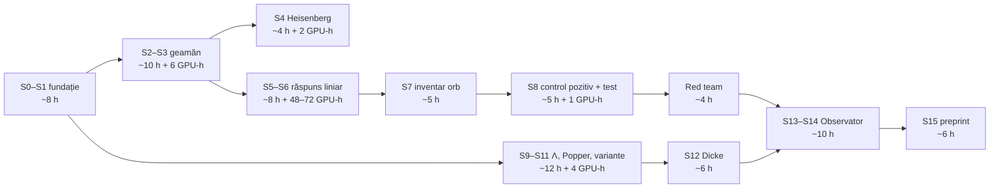

# Plan v6 — QL-Ξ „Testul orb”: v5 plus 12 upgrade-uri spre nivelul 10

> [!IMPORTANT]
> Nimic nu rulează până nu aprobi. `positive_claims_allowed=false`. INCIDENT_XI_00 (pornirea neautorizată de la 22:50) rămâne declarat; fișierele lui așteaptă decizia ta.
> v6 **păstrează integral** arhitectura, guvernatorul de resurse, porțile G0–G6 și estimările din [PLAN_V5](PLAN_V5_QL_XI.md). Mai jos sunt numai upgrade-urile.

## 0. Rezumatul upgrade-urilor

| # | Upgrade | Ce rezolvă |
|---|---|---|
| U1 | **Preregistrarea completă** a testului confirmator, cu formule | „Testul” devine verificabil matematic, nu doar descris |
| U2 | **Analiză oarbă cu cheia ta**: etichetele se permută la descărcare cu un secret HMAC pe care îl deții numai tu | Agentul fizic nu poate ajusta analiza după date. Standard din fizica particulelor, rar aplicat aici |
| U3 | **Echivalență TOST**: un rezultat nul devine afirmația pozitivă „bias < Δ, cu 95%” | Un nul nu mai este o „absență de rezultat”, ci cunoaștere |
| U4 | **Factor Bayes** cu prior din geamăn, raportat alături, fără rol de decizie | Arată cât de mult schimbă datele încrederea în fizică |
| U5 | **Analiză multivers** pe un set fixat de alegeri rezonabile | Robustețea se vede, nu se pretinde |
| U6 | **Red team pre-specificat**: 10 atacuri asupra propriului rezultat | Un auditor nu mai găsește primul defectul |
| U7 | **Laborator de calibrare fizică**, opțional | Geamănul se ancorează în măsurători reale, nu doar în presupuneri |
| U8 | **Securitatea lanțului**: hash-uri pe dependențe, ancorare temporală opțională | Integritatea sigiliilor nu mai depinde de încrederea în agent |
| U9 | **KPI-uri** măsurabile pentru plan și produs | „Succes” are o definiție numerică |
| U10 | **Drum critic** cu ore de lucru și GPU-ore | Costul real devine vizibil |
| U11 | **Cadru de joc responsabil** în produs | Calitate etică, nu doar tehnică |
| U12 | **Matrice de conformitate** AGENTS.md ↔ plan | Nicio regulă a proiectului nu e încălcată din neatenție |

---

## U1. Preregistrarea testului confirmator (schița care se sigilează în S1)

**Estimandul.** Pentru o arhivă *a* cu N_a extrageri de k din n, frecvențele sunt d_i = c_i / N_a − p₀, unde p₀ = k/n.

**Covarianța exactă sub H₀.** Fiecare extragere este o eșantionare fără întoarcere, deci:

$$\Sigma=\frac{p_0(1-p_0)}{N_a}\cdot\frac{n}{n-1}\left(I-\tfrac{1}{n}\mathbf{1}\mathbf{1}^\top\right)$$

**Vectorul de bias.** Vectorul b_a vine din fizică (răspunsul liniar R al geamănului aplicat masei de cerneală a glifelor din jocul *a*). Este centrat și **sigilat înainte de descărcare**.

**Statistica pe arhivă și pooling-ul:**

$$T_a=\frac{b_a^\top d}{\sqrt{b_a^\top\Sigma b_a}},\qquad T=\frac{\sum_a\sqrt{N_a}\,T_a}{\sqrt{\sum_a N_a}}$$

- **Nulul exact:** 10⁶ arhive uniforme simulate pe GPU (Monte Carlo), nu doar aproximarea normală.
- **Decizia:** H₀ se respinge dacă p_MC < 0.01, unilateral, în direcția prezisă de fizică. Semnul este fixat înainte.
- **Testul de anotimp și emisferă:** interacțiunea (temperatura lunară medie a țării) × b_season. Predicția: coeficienți de **semn opus** între emisfere. Testul este secundar, cu α = 0.01, Bonferroni pe 2.
- **Fără încetare timpurie, fără date adăugate după decizie, o singură rulare.**

## U2. Analiza oarbă cu cheia deținută de tine

1. Generezi tu o frază secretă, pe care nu o vede nimeni altcineva.
2. Scriptul de descărcare aplică imediat o permutare a etichetelor, derivată din HMAC(frază, id-arhivă). Brutul se salvează **criptat** (age/openssl, cu aceeași frază). Agentul lucrează numai pe datele permutate.
3. Pe datele oarbe se rulează QC, controlul pozitiv și verificarea lanțului. Rezultatele oarbe sunt, prin construcție, de tip nul, deci nu se poate ajusta nimic spre un efect.
4. Codul se îngheață: sha-ul lui intră în `LANT_XI.jsonl`.
5. **Tu introduci fraza**, iar rularea unică are loc pe datele dezvăluite. Rezultatul este final.

Limita, spusă onest: agentul ar putea teoretic ocoli procesul. Protecția constă în jurnal, în hash-uri și în faptul că brutul necriptat nu există pe disc.

## U3–U5. Interpretare completă

- **TOST:** marja de echivalență Δ (MDE relativ) este fixată în S1. Dacă T nu respinge H₀ și intervalul de 90% al lui β cade în (−Δ, Δ), publicăm: *„orice bias de tip cerneală este sub Δ, cu încredere 95%”*.
- **Factor Bayes:** priorul pe amplitudinea A vine din posteriorul geamănului (incertitudinea parametrilor fizici). BF₁₀ se raportează descriptiv.
- **Multivers:** 3 variante de geometrie × 3 de mapare a cernelii × 2 de pooling = 18 specificații, toate fixate în avans. Afișăm curba specificațiilor. Decizia rămâne pe specificația principală.

## U6. Red team pre-specificat (sesiune dedicată, după rezultat, fără drept de modificare)

Atacurile:
1. scurgere de informații din RO în b;
2. duplicate sau erori în arhivele străine;
3. schimbări de format sau de reguli ale jocului în timp;
4. sensibilitatea la eliminarea unei țări (leave-one-out);
5. sensibilitatea la eliminarea unei epoci;
6. bug de semn;
7. calibrarea nulului Monte Carlo;
8. dependența dintre extragerile aceleiași zile;
9. eroarea surogatului față de DEM;
10. reproducerea independentă în Rust.

Fiecare atac are un criteriu de trecere fixat acum, iar rezultatele se publică lângă verdict.

## U7. Laboratorul de calibrare fizică (opțional; decizia ta, cu cost mic)

Ai nevoie de un tambur simplu și de un set de bile numerotate cu masă cunoscută, filmate cu telefonul la 240 fps. Pe GPU, urmărirea video (detecție și tracking) extrage coeficienții de restituție și frecare și distribuția timpilor de ieșire. Geamănul trebuie să le reproducă **înainte** de a produce b.

Alternativa fără cost: priori din toleranțele publice de fabricație ale bilelor de loterie, etichetate ca atare.

## U8. Securitatea lanțului

- `pip --require-hashes` și `Cargo.lock` pe dependențe;
- sha pe fiecare artefact, într-un lanț append-only 0444;
- ancorare temporală externă (OpenTimestamps), **numai dacă o aprobi**, deoarece AGENTS.md cere implicit sigilii locale;
- cheia de commit-reveal pentru cele 3 variante, derivată și păstrată separat de cod.

## U9. KPI-uri

| KPI | Țintă |
|---|---|
| K1 Testul confirmator rulat exact conform preregistrării | 100%, o singură rulare |
| K2 Detecția controlului pozitiv la MDE | ≥ 80% (puterea declarată) |
| K3 FDR empiric Popper pe fluxuri nule | ≤ 5% |
| K4 Paritate Python ↔ Rust pe numerele afișate | 100% |
| K5 Probe vechi atinse | 0 |
| K6 Utilizarea GPU în campanii | ≥ 85%, cu cedare la ferestre |
| K7 `verifica_tot` pe o clonă curată | PASS |
| K8 Incidente nedeclarate | 0 |

**Succesul proiectului este independent de semnul rezultatului.** Un nul cu TOST este la fel de valid ca o respingere.

## U10. Drum critic și cost

Total: circa **78 de ore de lucru și 60–85 de GPU-ore**, în aproximativ 16 sesiuni. Campaniile de GPU rulează în timp ce se scrie restul.

## U11. Joc responsabil (în produs)

Fiecare ecran cu variante afișează:
- **pierderea așteptată pe bilet, în lei**;
- șansa exactă de câștig;
- mențiunea „nu este sfat de joc”;
- un link spre resurse de ajutor.

Produsul nu folosește niciun limbaj de tipul „câștig sigur”.

## U12. Conformitate cu AGENTS.md

| Regulă | Cum o respectă planul |
|---|---|
| Protocol înainte de cod sau calcule | fiecare sesiune începe cu un protocol sigilat |
| Fără subagenți, bani, contacte, joburi autonome | zero; QPU, OpenTimestamps și laboratorul fizic sunt numai la decizia ta |
| Git numai prin `./dev-git`, fără add/commit | respectat |
| Rezultatele negative se publică, fără rescriere | TOST, red team și lanțuri 0444 |
| Arhiva RO este explorată, fără set nevăzut | RO rămâne explorativă; confirmarea vine numai din date străine oarbe |
| HANDOFF/PROMPT la checkpoint, cu mesajele persistente | la fiecare poartă |
| Nu reluăm modelele închise | b vine din fizică, nu din reantrenarea GL/SE |

## Deciziile tale

1. **INCIDENT_XI_00:** arhivare (recomandat) sau ștergere?
2. **S33_01:** opțiunea A?
3. **Arhive străine cu analiză oarbă (U2):** aprobi? Accepți să păstrezi tu fraza secretă?
4. **SSD:** aprobi până la 1.5 TB?
5. **Laboratorul fizic (U7):** da (cost mic, al tău) sau varianta fără cost?
6. **OpenTimestamps (U8) și QPU:** da, nu, sau mai târziu?
7. **Aprobare pe etape:** aprobi doar faza A acum (recomandat)?
