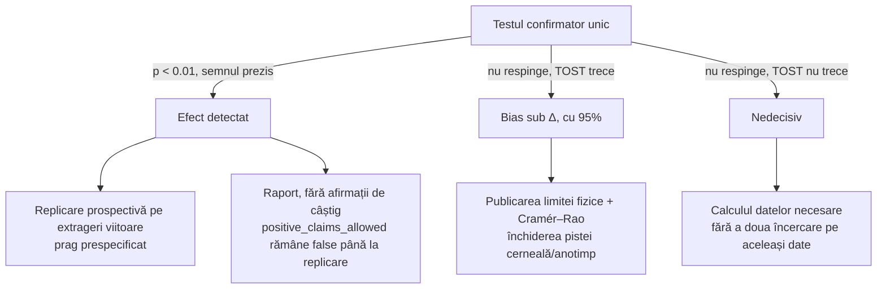

# Plan v8 — QL-Ξ „Certificatul complet”: v7 plus upgrade-urile de la 8 spre 10

> [!IMPORTANT]
> Nimic nu rulează până nu aprobi. `positive_claims_allowed=false`. v8 păstrează integral v7 (bariera Ehrenfest, simularea cuantică GPU, tetrada, testul orb, TOST, red team, KPI-uri, guvernatorul de resurse). INCIDENT_XI_00 rămâne declarat.
> **Ce lipsea la 8:** subtilitățile fizice, demonstrațiile verificate automat, guvernanța datelor și a operării, specificația produsului și un plan clar pentru *ce urmează după rezultat*.

---

## V1. Ierarhia surselor de zgomot (corectează o slăbiciune fizică din v7)

v7 folosea t_E cu ħ „pur”. Un evaluator riguros ar obiecta pe două puncte:
1. Decoerența puternică *înlocuiește* scara ħ cu scara de difuzie indusă de mediu (Zurek & Paz, *PRL* 72, 1994).
2. Zgomotul termic clasic (Brownian, aer) poate domina zgomotul cuantic.

v8 calculează **toate sursele, ordonate**:

| Sursă | Scara inițială δ₀ | Timpul de amplificare t = λ⁻¹ ln(L/δ₀) |
|---|---|---|
| Punct zero cuantic, limitat de decoerență | lungimea de coerență ℓ_c = ħ/√(2D) | calculat |
| Mișcare Browniană (aer, 300 K) | √(k_BT/(mω²)) pe durata unei coliziuni | calculat |
| Vibrațiile mașinii, acustică | spectru estimat | calculat |
| Turbulența aerului (în varianta cu aer) | scara Kolmogorov | calculat |
| Momentul pornirii (operatorul) | ±10 ms × viteză | calculat |

- **λ granular disipativ:** se ia din geamăn și se validează pe spectrul Lyapunov al fluidelor de discuri dure (Dellago & Posch, 1995–1997), cu corecția pentru coliziuni inelastice.
- **Livrabilul:** *care sursă decide rezultatul și în cât timp*. Concluzia onestă poate fi că zgomotul termic domină. În acest caz, originea cuantică rămâne o afirmație *de principiu* (Albrecht–Phillips), nu una operațională. Ambele variante se publică.

## V2. Certificatul de amestec pe graful Johnson (clasic față de cuantic)

Amestecarea bilelor până la selecția unei 6-mulțimi este, ca model, **difuzia Bernoulli–Laplace** pe graful Johnson J(49,6). Distanța de variație totală până la uniform are **formulă spectrală exactă** (Diaconis & Shahshahani, 1987), cu **aceleași** valori proprii θ_m = (k−m)(n−k−m) − m pe care v7 le folosește pentru mixerul cuantic XY.

- **Calculul:** geamănul DEM măsoară rata efectivă de „schimburi” pe secundă. Formula exactă dă TV(t) și momentul de cutoff.
- **Certificatul:** „în 30 s de amestec, distanța TV ≤ ε”, cu ε numeric și intervale pe familia de mașini.
- **Comparația cuantică:** mersul cuantic continuu pe același graf, simulat exact în subspațiul Dicke, arată cât de diferit (balistic față de difuziv) s-ar răspândi o urnă cuantică.
- **Valoarea:** aceeași mașinărie spectrală unifică fizica clasică a urnei și stratul cuantic. Componenta cuantică devine necesară matematic.

## V3. Demonstrații verificate automat (Lean 4 + Mathlib)

Patru leme centrale se demonstrează formal, cu fallback în verificare simbolică exactă (SymPy/`Fraction`) dacă Mathlib nu le acoperă:
1. Covarianța indicatorilor la eșantionarea fără întoarcere, adică matricea Σ din testul confirmator.
2. Inegalitatea mixturii: log m ≥ log q_h + log w_h, baza marginii Λ.
3. Raportul de verosimilitate față de uniform este e-valoare sub H₀: E[q/u] = 1.
4. Valorile proprii ale grafului Johnson J(n,k), pe cazuri mici verificate exhaustiv, cu forma generală citată.

Rezultatul este un raport cu teoremele, sha-ul fișierelor `.lean` și versiunea Mathlib.

## V4. Puterea, în tabel analitic

Pentru p = 6/49, α = 0.01 unilateral și putere 0.8, cu un bias aliniat cu b:

$$\text{MDE}_{rel}\approx\frac{3.17}{7}\sqrt{\frac{1-p}{pN}}$$

| N extrageri | MDE relativ pe număr |
|---|---|
| 2 598 (RO) | 2.4% |
| 10 000 | 1.2% |
| 20 000 | 0.86% |
| 50 000 | 0.54% |

**Eterogenitatea:** meta-analiză cu efecte aleatoare, cu τ² estimat REML. Prespecificat: dacă I² > 50%, decizia se ia pe efectul *mediu*, iar fiecare arhivă se raportează separat. Straturile pe epoci ale mașinilor se folosesc acolo unde documentația publică le stabilește.

## V5. Guvernanța datelor și operarea

| Domeniu | Măsura |
|---|---|
| Legalitate | respectarea ToS și robots.txt; descărcări rare, cu user-agent declarat; licențele datelor consemnate |
| Stocare | adresare pe conținut (sha256) pe SSD; manifest per versiune |
| Backup | manifestele și sigiliile copiate pe discul intern; corpusul DEM se poate regenera din seed |
| Reluare | checkpoint la fiecare N minute pentru DEM, simularea cuantică și Popper; reluare deterministă |
| Telemetrie | NVML (utilizare, VRAM, temperatură, putere) în guvernator, înregistrată fără praguri termice proprii (conform AGENTS.md) |
| Ferestre | guvernatorul cedează GPU-ul la ±15 min de emisii și decontări; jurnal de cedări |

## V6. Specificația produsului (Observatorul Tauri v2)

- **Ecranul principal:** Tetrada limitelor (4 cadrane), cu bara „pierdere așteptată pe bilet” mereu vizibilă.
- **Filele:**
  - Bariera Ehrenfest: ierarhia zgomotelor și animația pachetului de undă;
  - Amestec: TV(t), clasic față de cuantic;
  - Testul orb: starea G0–G6 și verdictul;
  - Λ/Popper;
  - Cele 3 variante sigilate;
  - Laboratorul Dicke.
- **Teste automate:**
  - capturi de ecran deterministe comparate cu referințe;
  - paritatea fiecărui număr afișat cu verificatorul Rust;
  - accesibilitate (contrast, tastatură).

## V7. Kitul de replicare (oricine, inclusiv auditorii tăi AI)

O singură comandă, `verifica_tot`, reproduce determinist toate certificatele. Kitul vine cu **hash-urile așteptate** publicate, ca un terț să poată confirma sau infirma rezultatul fără să aibă încredere în agent. Datele străine oarbe se distribuie numai după dezvăluirea frazei tale.

## V8. Registrul aprobărilor (după INCIDENT_XI_00)

Fiecare poartă (G0–G6) se deschide numai printr-o intrare în `APROBARI_XI.jsonl`, cu momentul, poarta și formularea aprobării tale. Intrările sunt înlănțuite prin hash. Opțional, sunt semnate HMAC cu fraza ta, ca să nu poată fi fabricate. Codul refuză să pornească o fază fără aprobarea ei.

## V9. Ce urmează după rezultat (arbore de decizie fixat acum)

## V10. Rezumatul a ce este cu adevărat nou (de confirmat în auditul bibliografic din S1)

Combinația urmărită: (i) bias a priori din fizică, (ii) test confirmator orb pe date multinaționale nevăzute, cu emisfere și TOST, (iii) bariera Ehrenfest calculată prin simulare cuantică pe GPU, cu ierarhia zgomotelor, (iv) certificatul de amestec Johnson, unificat cu mixerul cuantic, (v) leme verificate automat, (vi) lanț complet sigilat și replicabil. **Nu revendic noutate mondială înainte de audit.**

---

## Costul actualizat

Față de v7: +1 sesiune pentru V1, +1 pentru V2, +1 pentru V3 (Lean), plus V5–V8 integrate în sesiunile existente.

Total: circa **22 de sesiuni, ~110 ore de lucru și 90–125 GPU-ore**, plus 1.0–1.5 TB pe SSD.

## Deciziile tale

1. **INCIDENT_XI_00:** arhivare (recomandat) sau ștergere?
2. **S33_01:** opțiunea A?
3. **Arhive străine cu analiză oarbă**, inclusiv fraza secretă păstrată de tine: aprobi?
4. **SSD:** aprobi până la 1.5 TB?
5. **Laboratorul fizic (U7):** da sau varianta fără cost?
6. **QPU, OpenTimestamps și Lean 4** (instalare de câțiva GB): da, nu sau mai târziu, pentru fiecare?
7. **Aprobare pe etape:** aprobi doar faza A acum (recomandat)?
