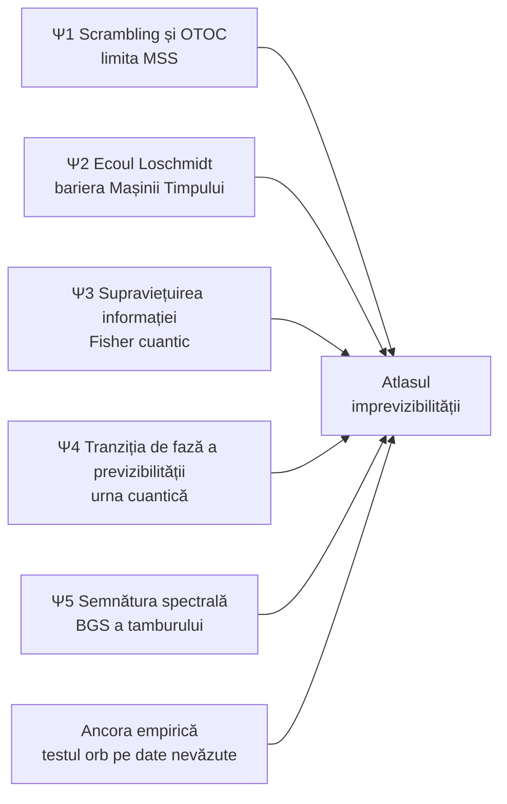

# Plan v9 — QL-Ξ „Atlasul cuantic al imprevizibilității”

> [!IMPORTANT]
> Nimic nu rulează până nu aprobi. `positive_claims_allowed=false`. INCIDENT_XI_00 rămâne declarat.
> **Răspuns direct la audit („nivel comercial”):** v9 trece produsul în anexă și pune în centru **un program de cercetare cuantică de nivel academic**. Are 5 ipoteze falsificabile, fiecare calculată efectiv pe GPU, cu predicții scrise *înainte* și criterii de infirmare.
> Onestitate: urna reală este un sistem clasic decoerat. Modelele cuantice de mai jos sunt **sisteme reale de fizică cuantică** (biliarde cuantice, lanțuri de spini) care răspund la întrebarea de fond: *unde și de ce moare previzibilitatea?* Ele nu sunt afirmații despre mașina RO.

---

## Întrebarea centrală

> **Care sunt barierele fizice fundamentale dintre trecutul unei urne și extragerea următoare, și unde se află urna de loterie pe harta haosului cuantic, alături de biliarde, lanțuri de spini și găuri negre?**

Ancora empirică rămâne testul confirmator orb din v8 (arhive străine, bias a priori din fizică). În jurul ei, v9 construiește **atlasul**:

---

## Ψ1 — Scrambling: unde stă urna față de găurile negre

**Fizica.** Corelatorul în afara ordinii temporale (OTOC),

$$C(t)=-\langle[\hat x(t),\hat p]^2\rangle\sim\hbar_{\text{eff}}^2\,e^{2\lambda_Q t},$$

crește exponențial până la **timpul de scrambling**

$$t^*\approx\frac{1}{\lambda}\ln\frac{1}{\hbar_{\text{eff}}}.$$

Rata λ_Q este mărginită de **limita haosului** Maldacena–Shenker–Stanford (2016), λ ≤ 2πk_BT/ħ, pe care găurile negre o saturează (Sekino–Susskind: „fast scramblers”). Referințe: Larkin–Ovchinnikov (1969); Rozenbaum–Ganeshan–Galitski (2017), despre OTOC în biliarde.

**Calculul.**
- Biliard cuantic cu geometria tamburului, cu bile-obstacol fixe în variantele Sinai/stadion. Split-operator FFT pe GPU, grilă 4096² complex64.
- OTOC prin 4 evoluții înainte și înapoi pe fiecare moment.
- Scanare ħ_eff = 10⁻² → 2·10⁻⁴.

**Predicția fixată acum.**
- λ_Q ≈ λ_clasic, cu toleranță de 20%.
- t* liniar în ln(1/ħ_eff), cu panta 1/λ.

**Infirmare.** Panta în afara toleranței sau o creștere fără regim exponențial. Rezultatul se publică.

**Rezultatul pentru atlas.** Urna reală, cu λ ≈ 10–100 s⁻¹, se plasează pe harta limitei MSS: la 300 K, λ_MSS ≈ 2.5·10¹⁴ s⁻¹, adică **circa 12–13 ordine de mărime sub găurile negre**. Este o cifră *calculată*, cu bare de eroare.

## Ψ2 — Ecoul Loschmidt: de ce „Mașina Timpului” este imposibilă fizic

**Fizica.** Ecoul Loschmidt măsoară cât de bine se întoarce sistemul în starea inițială dacă îl rulezi înapoi cu o perturbație minimă ε:

$$M(t)=\left|\langle\psi_0|e^{i\hat H_\varepsilon t/\hbar}e^{-i\hat Ht/\hbar}|\psi_0\rangle\right|^2$$

Rezultatul profund al lui Jalabert & Pastawski (*PRL* 2001): în regimul haotic, M(t) ~ e^{−λt}, **independent de ε**. Ireversibilitatea este dictată de exponentul Lyapunov clasic, nu de cât de mică e perturbația.

**Calculul.** Același biliard, perechi de evoluții (H, H_ε) pe GPU, cu ε scanat pe 4 decade.

**Predicția.**
- regim Fermi-golden-rule (Γ ∝ ε²) la ε mic;
- platou Lyapunov (Γ ≈ λ, independent de ε) la ε intermediar.

**Infirmare.** Lipsa platoului.

**Rezultatul pentru produs.** Fila „Mașina Timpului” încetează să mai fie un „NERULAT”. Arată **de ce** trecutul nu se poate inversa: curba M(t) și platoul λ.

## Ψ3 — Supraviețuirea informației: câtă informație despre o imperfecțiune ajunge în extragere

**Fizica.** Pentru un parametru θ (masa unei bile, de exemplu), informația Fisher cuantică a stării,

$$F_Q=4\left(\langle\partial_\theta\psi|\partial_\theta\psi\rangle-|\langle\psi|\partial_\theta\psi\rangle|^2\right),$$

mărginește informația Fisher clasică F_C a rezultatului observat: F_C ≤ F_Q (Braunstein–Caves, 1994).

**Calculul.** În biliardul cuantic, F_Q(t) se obține prin diferențe finite pe θ. F_C(t) se calculează pe distribuția „portului de ieșire”, adică pe analogul bilei extrase.

**Livrabilul.** Curba η(t) = F_C/F_Q, **fracția de informație care supraviețuiește** din starea completă până la rezultatul de tip „număr extras”.

**Legătura cu restul planului.** η(t) leagă direct fizica de metrologie (limita Cramér–Rao din tetradă) și de testul empiric: arată cât de mult poate „vedea” o arhivă de extrageri dintr-o imperfecțiune fizică.

**Predicția.** η scade pe scara t_E. **Infirmare:** η rămâne constant dincolo de t_E.

## Ψ4 — Tranziția de fază a previzibilității în urna cuantică *(piesa de cercetare de frontieră)*

**Modelul.** Subspațiul Dicke (k excitații din n situri) cu hamiltonianul

$$\hat H=-\sum_{i<j}J_{ij}\left(\sigma^+_i\sigma^-_j+\text{h.c.}\right)+\sum_i h_i\,\hat n_i,\qquad h_i\sim U[-W,W]$$

**Capcana, identificată acum.** Cu J_ij uniform, H este exact **modelul Richardson (BCS redus), integrabil pentru orice h_i**. Statistica nivelurilor rămâne Poisson indiferent de dezordine. Acest caz devine **control negativ încorporat** pentru toți indicatorii de haos.

**Varianta haotică.** J_ij provine din **graful de contacte bilă–bilă al geamănului DEM** (frecvența contactelor). Clasicul și cuanticul se cuplează direct, iar integrabilitatea se rupe.

**Întrebarea.** La ce dezordine W_c trece urna cuantică din fază **ergodică**, unde uită starea inițială și „extragerea” e uniformă (ETH), în fază **localizată** (MBL), unde ține minte starea inițială și extragerea devine previzibilă?

**Calculul, folosind la maximum GPU și CPU.**
- **Statistica r̄:** Poisson 0.386, GOE 0.531 (Oganesyan–Huse, 2007; Atas et al., 2013).
  - Diagonalizare densă pe GPU pentru n = 12…18 (dimensiune până la C(18,6) = 18 564), sute de realizări de dezordine.
  - Verificare fp64 în paralel pe CPU, cu 24 de fire.
- **Parametrul de ordine al previzibilității:** divergența KL a marginalei ansamblului diagonal față de uniform, plus entropia de participare în spațiul Fock.
- **Dinamica la n = 49, k = 6:** 14M amplitudini, evoluție Chebyshev pe GPU, cu memoria stării inițiale în funcție de t.
- **Scalare la dimensiune finită**, pentru W_c și exponenți.

**Predicția.**
- Richardson: r̄ ≈ 0.386 pentru orice W (control).
- Graful DEM: r̄ ≈ 0.53 la W mic, apoi tranziție spre 0.386.

**Infirmare.**
- controlul Richardson nu dă Poisson, ceea ce înseamnă un bug;
- sau nu există niciun regim GOE.

**Semnificația, spusă onest.** Ψ4 arată că **previzibilitatea este o proprietate de fază**. O urnă *cuantică* devine previzibilă numai dacă imperfecțiunile depășesc un prag critic. Pentru urna reală, decoerată și clasică, analogul este pragul de imperfecțiune peste care bias-ul ar deveni detectabil. Pragul acesta se compară cu MDE-ul testului empiric.

## Ψ5 — Semnătura spectrală a tamburului (Bohigas–Giannoni–Schmit)

**Fizica.** Conjectura BGS (1984): sistemele clasic haotice au spectre cuantice de tip matrice aleatoare (GOE).

**Calculul.** Primele circa 10⁴ valori proprii ale laplacianului în geometria tamburului (cu obstacole), prin Lanczos rar pe GPU. Se măsoară distribuția distanțelor dintre niveluri, factorul de formă spectral (rampa) și statistica r̄.

**Predicția.** GOE pentru geometria haotică; Poisson pentru discul gol, care este integrabil și servește drept control.

**Rezultatul.** Semnătura cuantică a haosului geometriei urnei.

---

## Bugetul de calcul (GPU și CPU concurent, SSD pentru spectre și stări)

| Program | GPU | CPU (24 de fire) | SSD |
|---|---|---|---|
| Ψ1 OTOC | 15–25 GPU-h (FFT 4096²) | analiza și verificarea pe grile mici în fp64 | stări checkpoint, ~50 GB |
| Ψ2 Loschmidt | 8–12 GPU-h | analiză | ~20 GB |
| Ψ3 Fisher | 6–10 GPU-h | diferențe finite fp64 | ~10 GB |
| Ψ4 Faze | 25–40 GPU-h (eigh fp32 + Chebyshev la 14M) | eigh fp64 de verificare, în paralel | spectre, ~100 GB |
| Ψ5 BGS | 4–8 GPU-h (Lanczos rar) | — | ~5 GB |
| **Atlas total** | **≈ 60–95 GPU-h** | ocupare continuă | **≈ 200 GB** |

Restul infrastructurii din v8 rămâne neschimbat și se adaugă: geamăn DEM, testul orb, Λ/Popper, Lean, guvernatorul de resurse, registrul aprobărilor. **Totalul proiectului: circa 150–220 GPU-ore și circa 26 de sesiuni.**

## Fazele (atlasul în centru)

| Fază | Sesiuni | Conținut | Poartă |
|---|---|---|---|
| A | S0–S1 | deblocare legitimă, protocolul-mamă, audit bibliografic, sondă de fezabilitate | G0, G1 |
| B | S2–S4 | motorul cuantic GPU (split-operator, Lanczos, Chebyshev, eigh), validat exact | G2: conservare ≤ 10⁻⁸, diagonalizare exactă pe cazuri mici |
| C | S5–S10 | Ψ1–Ψ5, fiecare cu predicția sigilată înainte | o poartă per program |
| D | S11–S16 | geamănul DEM (λ, graful de contacte pentru Ψ4), răspunsul liniar, ierarhia zgomotelor, amestecul Johnson | G3 |
| E | S17–S19 | testul orb confirmator, red team | G4 |
| F | S20–S23 | Λ/Popper, leme Lean, cele 3 variante sigilate | G5 |
| G | S24–S26 | Atlasul în Observatorul Tauri, preprint, kit de replicare | G6 |

## Anexa: ce rămâne din v8 (neschimbat)

Testul orb cu fraza ta, preregistrarea cu Σ exactă, TOST, Bayes, multivers, red team, ierarhia zgomotelor, certificatul Johnson, Lean 4, guvernanța datelor, KPI-urile, kitul de replicare, registrul aprobărilor, arborele de decizie post-rezultat și jocul responsabil.

## Deciziile tale

1. **INCIDENT_XI_00:** arhivare (recomandat) sau ștergere?
2. **S33_01:** opțiunea A?
3. **Arhive străine cu analiză oarbă**, inclusiv fraza secretă păstrată de tine: aprobi?
4. **SSD:** aprobi până la 1.5 TB?
5. **Laboratorul fizic:** da sau varianta fără cost?
6. **QPU real** (Ψ4 la scară mică pe hardware: experiment de ergodicitate și localizare), OpenTimestamps și Lean 4: da, nu sau mai târziu, pentru fiecare?
7. **Aprobare pe etape:** aprobi doar faza A acum (recomandat)?
